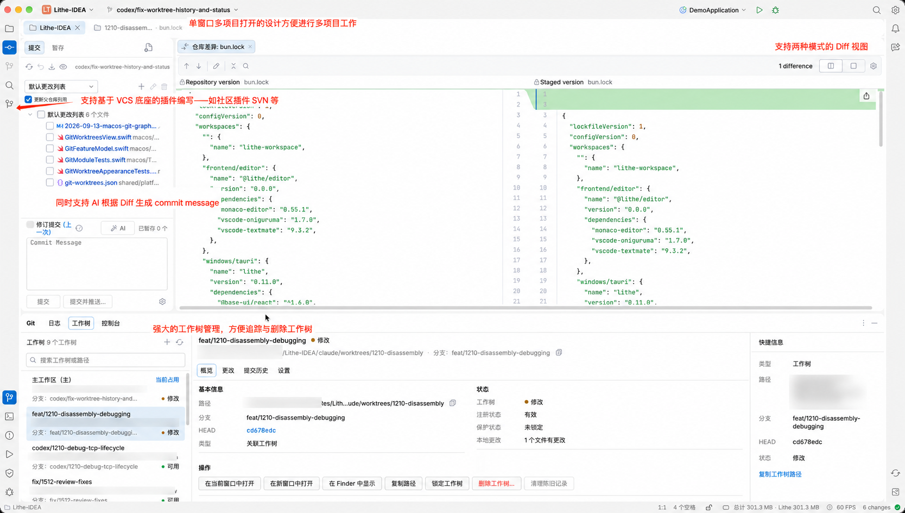
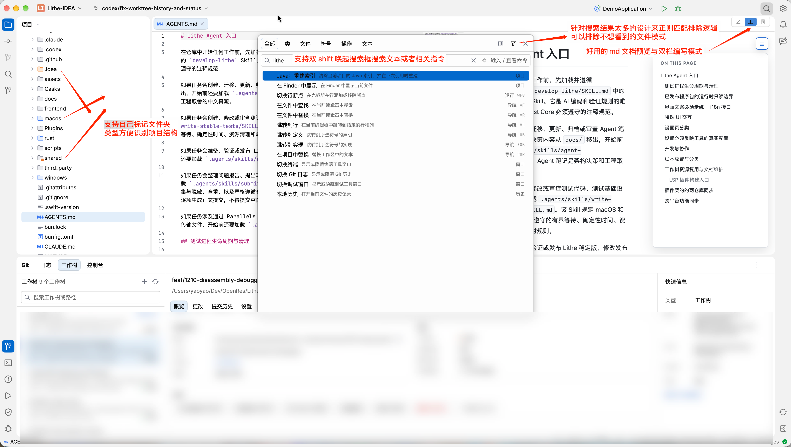
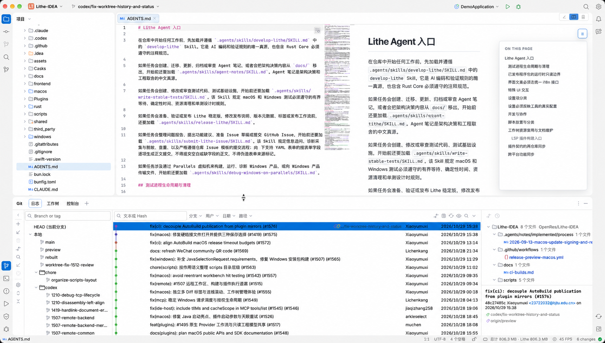
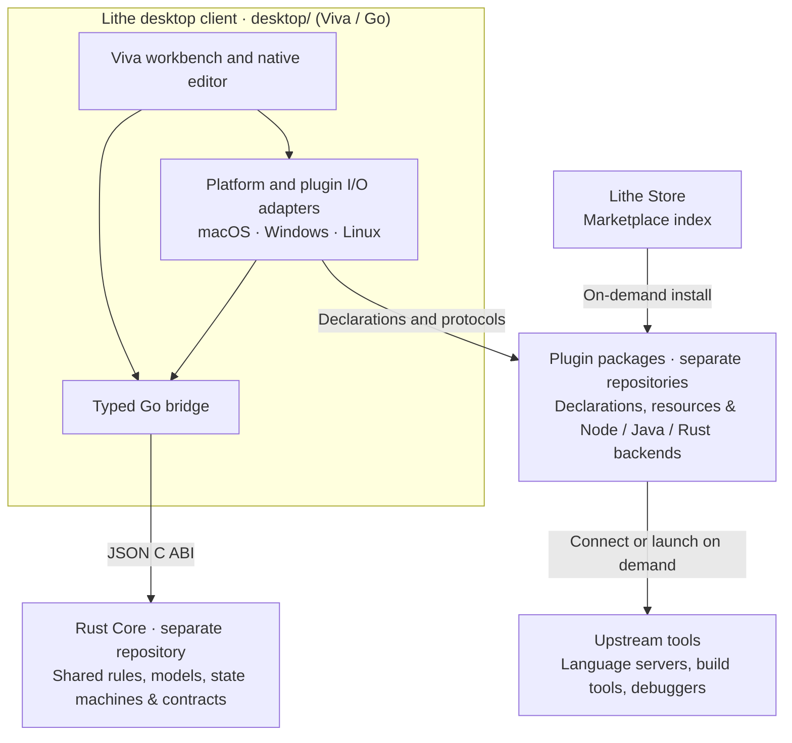
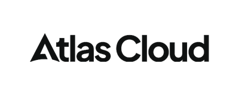

<div align="center">
  

  <h1>Lithe</h1>

  <p><strong>An ultra-lightweight, low-latency, pluggable cross-platform native IDE — powered by Rust Core and Viva (Go)</strong></p>

  <p>
    <a href="./README.zh-CN.md"><strong>简体中文</strong></a> ·
    <a href="#performance-benchmarks">Benchmarks</a> ·
    <a href="#download-and-install">Download</a> ·
    <a href="https://github.com/Lithe-IDEA/Lithe-store">Plugin marketplace</a> ·
    <a href="https://github.com/Lithe-IDEA/Lithe-core-rust/tree/main/shared/plugins">Plugin development</a>
  </p>

  <p>
    <a href="https://hellogithub.com/repository/1lck/Lithe-IDEA" target="_blank"></a>
    <a href="https://trendshift.io/repositories/124763?utm_source=repository-badge&amp;utm_medium=badge&amp;utm_campaign=badge-repository-124763" target="_blank" rel="noopener noreferrer"></a>
    <a href="https://atomgit.com/lithe_IDEA/Lithe-IDEA"></a>
  </p>

  <p>
    <a href="https://github.com/1lck/Lithe-IDEA/releases/latest"></a>
    <a href="https://github.com/1lck/Lithe-IDEA/releases"></a>
    
    
    
    <a href="#download-and-install"></a>
    <a href="./LICENSE"></a>
  </p>
</div>

https://github.com/user-attachments/assets/17e2325b-afed-4bbb-9926-a962f777269b

## Join the Community

Join the Lithe community to share feedback, discuss performance and plugins, and follow the latest updates.

<div align="center">
<table>
  <tr>
    <th>QQ group</th>
    <th>WeChat group</th>
  </tr>
  <tr>
    <td align="center"><a href="https://qm.qq.com/cgi-bin/qm/qr?k=&amp;group_code=163027877"></a></td>
    <td align="center"><a href="https://gcnctzuuwe9u.feishu.cn/wiki/HJFbwZ0hZirAPnkWF3xcPWkCnid?from=from_copylink"></a></td>
  </tr>
</table>
</div>

If you cannot scan the WeChat QR code, [click here to join through Feishu](https://gcnctzuuwe9u.feishu.cn/wiki/HJFbwZ0hZirAPnkWF3xcPWkCnid?from=from_copylink).

## About Lithe

> **AI writes the code. Lithe helps you understand the project, run and debug it, and review every change.**

Rebuilt on **Viva (Go native workbench) + Rust Core**, Lithe is a modular, pluggable cross-platform native IDE. The core workbench leaves behind Electron / WebView overhead—starting in **under 1 second** with **171 MB** steady memory—while language servers, build tools, run targets, and debuggers plug in independently on demand.

| Capability | Overview |
| --- | --- |
| **Native Editor & Search** | High-performance native editor, project tree, file tabs, and Search Everywhere (files, symbols, actions). |
| **Deep Git Review** | Changed files, split/inline diffs, commits, branch history, and first-class Git worktree management. |
| **On-Demand LSP, Build & Debug** | Independent plugins connect language servers, build tasks, and debuggers (DAP / native) only when needed—zero idle drain. |
| **AI Assist & Plugin Ecosystem** | AI commit messages, pull request descriptions, and inline edits, MCP, and live resource monitor; extensible via Rust, Go, Node, and Java plugin SDKs ([Lithe Store](https://github.com/Lithe-IDEA/Lithe-store)). |

> Track per-platform completeness on the [Feature Matrix & Decision Board](https://1lck.github.io/Lithe-IDEA/).

---

## Performance Benchmarks

### Layer 1: Cold Startup & Idle Resource Usage

| Editor | Project window shown | Startup to idle | Steady memory | Peak memory | Idle CPU | Cumulative CPU time | Processes / Threads |
| --- | --- | --- | --- | --- | --- | --- | --- |
| **Lithe 0.7.0** | 0.67 s | **0.97 s** | **171 MB** | **246 MB** | **0.01%** | **1.9 s** | 4 / 31 |
| GoLand 2026.2.4 | 2.27 s | 9.77 s | 2658 MB | 2954 MB | 7.11% | 56.4 s | 9 / 259 |
| VS Code 1.146.0 | 1.27 s | 4.58 s | 697 MB | 1383 MB | 0.86% | 10.1 s | 12 / 232 |
| Zed 1.28.1 | **0.51 s** | 1.43 s | 188 MB | 274 MB | 0.58% | 2.3 s | 3 / 30 |

### Layer 2: Real-World Interaction Latency (`Lithe-IDEA` repo `app.go`, median of 5 runs)

| Metric | Lithe | Zed | GoLand |
| --- | --- | --- | --- |
| Open to ready | 8.31 s | 6.59 s | 26.0 s |
| Go to Definition (first response / frame settled) | 61 / **78 ms** | 62 / 149 ms | 79 / 165 ms |
| Hover | 552 ms | 382 ms | 569 ms |
| Hover, excluding editor debounce wait | **52 ms** (500 ms wait) | 82 ms (300 ms wait) | 69 ms (~500 ms wait) |
| Find References (first response / frame settled) | 78 / **94 ms** | 63 / 113 ms | 82 / 1365 ms |
| Typing (input / backspace) | **32 / 46 ms** | 64 / 64 ms | 62 / 64 ms |
| Peak memory / Cumulative CPU during test | 2163 MB / **62.5 s** | 2119 MB / 71.5 s | 4540 MB / 524.3 s |

---

## Download and Install

Starting from `0.8.1`, releases ship the unified Viva + Rust Core client as `Lithe Desktop.app` with built-in incremental self-updates:

- **macOS 13+ (Homebrew recommended):**

  ```bash
  brew tap lithe-idea/lithe https://github.com/1lck/Lithe-IDEA.git
  brew install --cask lithe-idea/lithe/lithe
  brew upgrade --cask lithe
  ```

  <details>
  <summary>Added the tap from the older repository URL? Click to migrate</summary>

  The previous tap at `https://github.com/Lithe-IDEA/Lithe-IDEA.git` is archived at `0.6.1`. Switch the tap to this repository before upgrading:

  ```bash
  brew tap --custom-remote lithe-idea/lithe https://github.com/1lck/Lithe-IDEA.git
  brew upgrade --cask lithe
  ```

  Upgrading from `0.6.x` automatically replaces the earlier `Lithe.app` with `Lithe Desktop.app`.

  </details>

- **macOS manual download:** Grab the `.dmg` from [GitHub Releases](https://github.com/1lck/Lithe-IDEA/releases/latest) (`arm64` for Apple Silicon, `amd64` for Intel).
- **Windows x64:** Download the Windows `.exe` installer from [GitHub Releases](https://github.com/1lck/Lithe-IDEA/releases/latest).
- **Linux x64 / arm64:** Install for your user with one command (no `sudo`). It downloads the release from the update feed, checks its SHA-256, puts `lithe` in `~/.local/bin` and adds Lithe to the application menu; Lithe then updates itself with incremental patches:

  ```bash
  curl -fsSL https://raw.githubusercontent.com/1lck/Lithe-IDEA/main/scripts/install/linux.sh | sh
  curl -fsSL https://raw.githubusercontent.com/1lck/Lithe-IDEA/main/scripts/install/linux.sh | sh -s -- uninstall
  ```

  The `.deb` and `.rpm` packages on [GitHub Releases](https://github.com/1lck/Lithe-IDEA/releases) are owned by the package manager and do not update themselves. To install by hand instead, unpack the Linux `.tar.gz` and run `./install.sh`.
- **Build from source / Pre-releases:** Check the [Releases](https://github.com/1lck/Lithe-IDEA/releases) notes, or follow [Develop Lithe](#develop-lithe) below.

<details>
<summary><strong>macOS says it cannot open or verify Lithe?</strong></summary>

Manually downloaded packages or ad-hoc signed AutoBuild builds without Apple notarization may be blocked on first launch. Confirm the download came from official [GitHub Releases](https://github.com/1lck/Lithe-IDEA/releases), then use one of these options:

<p align="center">
  
</p>

1. In **Applications**, Control-click `Lithe Desktop.app` (or legacy `Lithe.app`), choose **Open**, and click **Open** again in the confirmation dialog.
2. Open **System Settings > Privacy & Security**, click **Open Anyway** next to the warning, and launch the app again.
3. Remove the quarantine attribute in Terminal (only for trusted downloads; Homebrew installs usually do not need this):

   ```bash
   xattr -dr com.apple.quarantine "/Applications/Lithe Desktop.app"
   ```

</details>

---

## Product Tour

The screenshots below illustrate Lithe's core workflows (some captures are from the earlier macOS client and serve as workflow references; click any image for full resolution):

### Git, Diffs, and Worktrees

Switch projects in one window, review diffs, prepare commits, and inspect and manage Git worktrees.

<p align="center">
  <a href="./docs/assets/screenshots/git-diff-worktrees.png"></a>
</p>

### Search Everywhere and Markdown Preview

Double-Shift searches files, symbols, and actions. Edit Markdown alongside its preview and navigate with the table of contents.

<p align="center">
  <a href="./docs/assets/screenshots/search-everywhere-markdown.png"></a>
</p>

<details>
<summary>More workflow screenshots (Git history / Run services / Native debugging / AI chat & MCP)</summary>

### Git History and Branches

Browse Git history with a branch list, commit graph, filters, and changed files.

<p align="center">
  <a href="./docs/assets/screenshots/git-history-markdown.png"></a>
</p>

### HTML Preview and Run Services

Edit HTML alongside its preview and browse project entry points and service configurations in the Run panel.

<p align="center">
  <a href="./docs/assets/screenshots/html-preview-run-services.png"></a>
</p>

### Plugin Management and Native Debugging

Manage language, build, and debugger plugins. The screenshot also shows LLDB disassembly and registers.

<p align="center">
  <a href="./docs/assets/screenshots/plugins-native-debugging.png"></a>
</p>

### AI Chat and Context

Chat with an agent in the editor area, expand command output, and inspect context usage, file changes, and session statistics.

<p align="center">
  <a href="./docs/assets/screenshots/agent-chat-context.png"></a>
</p>

### Agent Resources and MCP Configuration

Manage agent instructions, skills, hooks, and MCP configuration, and inspect runtime and token usage in chat.

<p align="center">
  <a href="./docs/assets/screenshots/agent-mcp-settings.png"></a>
</p>

</details>

---

<a id="develop-lithe"></a>

## Develop Lithe

<details>
<summary><strong>Architecture overview, build, and validate from source (macOS / Windows / Linux)</strong></summary>

### Architecture Overview

Lithe separates **shared deterministic logic** from **native UI presentation**: **Viva (`desktop/`, Go)** handles cross-platform windows, native editor rendering, and OS I/O; **[Rust Core](https://github.com/Lithe-IDEA/Lithe-core-rust)** owns all shared rules and state machines via a typed JSON C ABI; plugins and their [contracts/SDKs](https://github.com/Lithe-IDEA/Lithe-core-rust/tree/main/shared/plugins) live separately, and installed bundles remain read-only at runtime for safe differential updates.



### Build & Validate

Building requires the Go toolchain pinned in `desktop/go.mod`, Rust/Cargo, and native platform dependencies (Xcode Command Line Tools on macOS; see [Desktop CI](./.github/workflows/desktop-ci.yml) for Windows and Linux). The `replace` directive in `desktop/go.mod` pins the Viva fork and revision.

Run the development build from the repository root (automatically prepares and links the pinned Rust Core):

```bash
./scripts/desktop/desktop-go.sh run ./cmd/lithe
```

Package the native installer (outputs to `dist/desktop/<os>-<arch>/` by default):

```bash
./scripts/desktop/package-desktop.sh
```

Validate the desktop client and repository checks:

```bash
./scripts/desktop/check.sh
./scripts/desktop/verify/verify-runtime-bundle-immutability.sh
node scripts/i18n/verify-app-language-localization.mjs
node scripts/i18n/generate-i18n.mjs --check
./scripts/platform-feature-matrix/verify-platform-feature-matrix.sh
```

- Validate plugin contract and SDK changes in [Lithe-core-rust](https://github.com/Lithe-IDEA/Lithe-core-rust), and plugin tests in their own repositories.
- Read [AGENTS.md](./AGENTS.md) and its development rules before contributing, and include your verification scope and platform status in PRs.

</details>

---

## Project Support

### ❤️ Sponsors

<p align="center">
  <a href="https://www.fastaitoken.com/">
    
  </a>
</p>
<p align="center">
  <a href="https://www.fastaitoken.com/"><strong>FastAI</strong></a><br>
  FastAI provides convenient relay access to a range of leading large language models, making it easier to connect AI capabilities to everyday development workflows. Its support helps Lithe continue improving its AI-assisted experience. Thank you to FastAI for supporting this project! Scan the QR code above to join the FastAI Token community chat group #2 (group ID: 1073874006).
</p>

<p align="center">
  <a href="https://pateway.ai/?ch=68i69k">
    
  </a>
</p>
<p align="center">
  Special thanks to PatewayAI for sponsoring this project!<br>
  PatewayAI focuses on premium official-source API relay, supporting Claude, GPT, and leading Chinese models with transparent billing and enterprise-level services.<br>
  Economy mode rates are as low as 5% of official pricing. <a href="https://pateway.ai/?ch=68i69k">Sign up for trial credits</a>, earn free credits in periodic campaigns, and receive mutual referral bonuses of up to $150 USD.
</p>

<p align="center">
  <a href="https://apinebula.ai/ref/8dhC67x0">
    
  </a>
</p>
<p align="center">
  Thanks to APINEBULA for sponsoring this project!<br>
  APINEBULA, an enterprise AI platform under Galaxy Video Bureau, provides access to Claude, GPT, Gemini, and other leading models through one API, with prices starting at 10% of standard rates. It supports high concurrency, formal contracts, corporate bank transfers, and invoicing for AI coding, agent development, and business integrations.<br>
  <a href="https://apinebula.ai/ref/8dhC67x0">Register through this link</a> and enter promo code <strong>Lithe</strong> on your first top-up to get 10% off.
</p>

<a href="mailto:2188718831@qq.com">Want to be featured below?</a>

<table>
  <tr>
    <td width="112" align="center">
      <a href="https://timicc.com">
        
      </a>
    </td>
    <td>
      <a href="https://timicc.com"><strong>TIMI CC</strong></a> is an enterprise AI relay platform focused on stability and service quality, providing fast, reliable model access for leading AI coding tools such as Claude Code and Codex.
    </td>
  </tr>
  <tr>
    <td width="112" align="center">
      <a href="https://www.deepsiderapi.com/?utm_source=lithe">
        
      </a>
    </td>
    <td>
      <a href="https://www.deepsiderapi.com/?utm_source=lithe"><strong>DeepSider API</strong></a> is a unified LLM API gateway for GPT, Claude, Gemini, DeepSeek, and more. Official provider channels, no shared account pools or reverse-engineered APIs. Rates start at 29% of official pricing, with real-time usage tracking and transparent billing.
    </td>
  </tr>
  <tr>
    <td width="112" align="center">
      <a href="https://zeusnorun.com/register?ref=AZD4UMG9">
        
      </a>
    </td>
    <td>
      <a href="https://zeusnorun.com/register?ref=AZD4UMG9"><strong>Zeus</strong></a> provides GPT, Claude, Grok, and GPT Image relay access at rates as low as 0.08×, with invoicing and corporate payment support.
    </td>
  </tr>
  <tr>
    <td width="112" align="center">
      <a href="https://dash.clidex.dev">
        
      </a>
    </td>
    <td>
      <a href="https://dash.clidex.dev"><strong>Clidex</strong></a> provides AI infrastructure and API access for native AI command-line tools at just 0.8% of official pricing. Thank you to Clidex for supporting Lithe!
    </td>
  </tr>
  <tr>
    <td width="112" align="center">
      <a href="https://www.atlascloud.ai/zh">
        
      </a>
    </td>
    <td>
      <a href="https://www.atlascloud.ai/zh"><strong>Atlas Cloud</strong></a> provides AI model relay services with access to <strong>over 400 models</strong>, giving developers more options through one platform. Thank you to Atlas Cloud for supporting Lithe!
    </td>
  </tr>
  <tr>
    <td width="112" align="center">
      <a href="https://www.compshare.cn?ytag=GPU_YY_YX_git_litheidea">
        
      </a>
    </td>
    <td>
      <a href="https://www.compshare.cn?ytag=GPU_YY_YX_git_litheidea"><strong>优云智算 Compshare</strong></a> UCloud’s AI cloud platform provides GPU computing and monthly or pay-per-use Coding Plans for Chinese AI models, with Claude Code, Codex, and API access. Its H3 video generation plans support up to 2K resolution and 30-second videos, starting at ¥0.08 per second. Enterprise concurrency, 24/7 technical support, and self-service invoicing are available.
    </td>
  </tr>
  <tr>
    <td width="112" align="center">
      <a href="https://codezsy.com/register?aff=fDyA">
        
      </a>
    </td>
    <td>
      <a href="https://codezsy.com/register?aff=fDyA"><strong>CodeZ</strong></a> provides stable relay access to GPT-family models for integrating model APIs into tools and projects. Thank you to CodeZ for supporting Lithe!
    </td>
  </tr>
</table>

### ⭐ Special Thanks

<p align="center">
  <a href="https://linux.do/">
    
  </a>
</p>

<p align="center">
  <strong>For all things AI, head to <a href="https://linux.do/">LINUX DO</a>. Wishing the community ever greater success.</strong>
</p>

### Contributors

Thank you to everyone who contributes to and improves Lithe.

<a href="https://github.com/1lck/Lithe-IDEA/graphs/contributors">
  
</a>

### License

Lithe is licensed under the [Apache License 2.0](./LICENSE).
