<div align="center">
  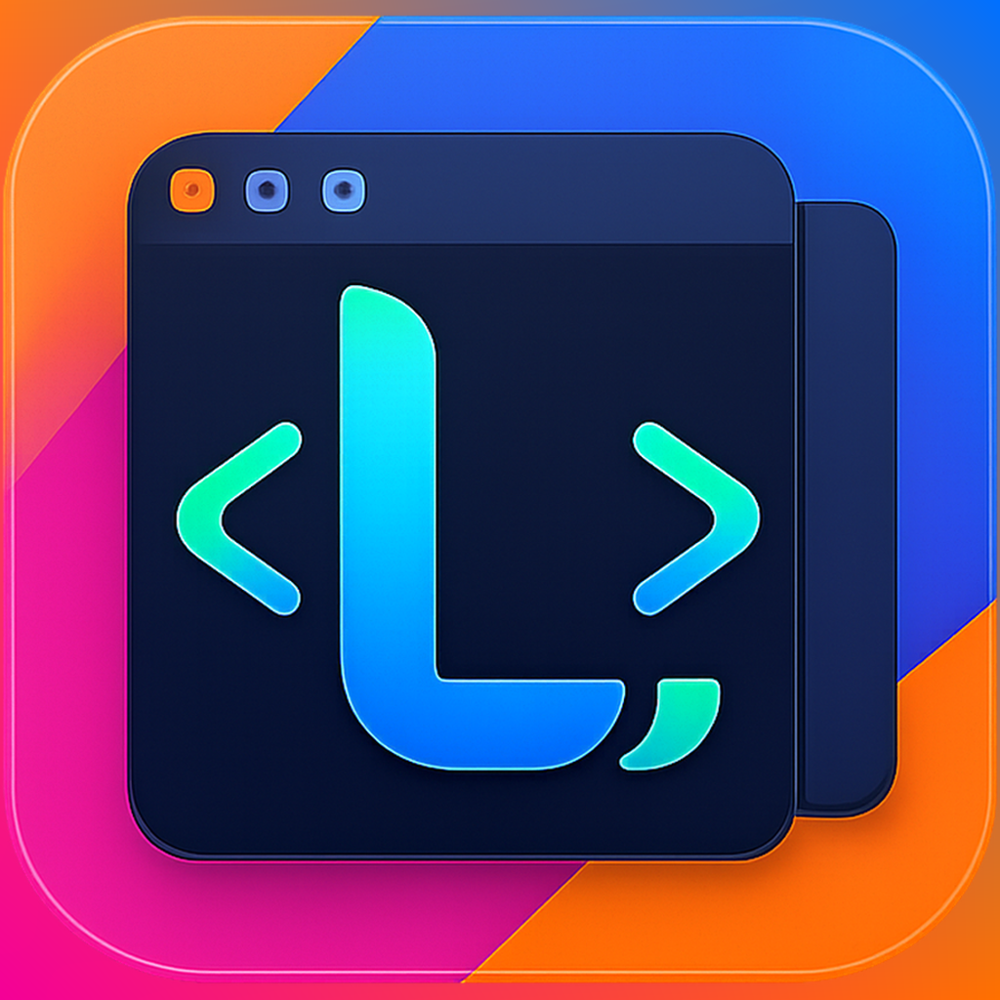

  <h1>Lithe</h1>

  <p><strong>A lightweight, general-purpose, cross-platform IDE, flexibly configured with plugins</strong></p>

  <p>
    <a href="./README.zh-CN.md"><strong>简体中文</strong></a> ·
    <a href="#performance-benchmarks">Benchmarks</a> ·
    <a href="#core-features">Core features</a> ·
    <a href="#download-and-install">Download</a> ·
    <a href="https://github.com/Lithe-IDEA/Lithe-store">Plugin marketplace</a> ·
    <a href="https://github.com/Lithe-IDEA/Lithe-core-rust/tree/main/shared/plugins">Plugin development</a> ·
    <a href="https://1lck.github.io/Lithe-IDEA/">Decision board</a> ·
    <a href="#develop-lithe">Develop Lithe</a>
  </p>

  <p>
    <a href="https://hellogithub.com/repository/1lck/Lithe-IDEA" target="_blank"></a>
    <a href="https://trendshift.io/repositories/124763?utm_source=repository-badge&amp;utm_medium=badge&amp;utm_campaign=badge-repository-124763" target="_blank" rel="noopener noreferrer"></a>
    <a href="https://atomgit.com/lithe_IDEA/Lithe-IDEA"></a>
  </p>

  <p>
    <a href="https://github.com/1lck/Lithe-IDEA/releases/latest"></a>
    <a href="https://github.com/1lck/Lithe-IDEA/releases"></a>
    
    
    <a href="#download-and-install"></a>
    <a href="./LICENSE"></a>
  </p>
</div>

## Why Lithe

AI coding tools can change many files at once. Reviewing that work still means reading the project, following symbols, running and debugging code, and checking each diff. Lithe brings those workflows into a workbench that can be extended with the tools a project needs.

## Meet Lithe

Lithe is a general-purpose IDE designed to keep resource use low and add capabilities through plugins. Its workbench brings together project browsing, editing, search, Git review, and terminals. Installed plugins connect language intelligence, build tools, run targets, and debuggers.

The current `preview` branch is developing a unified desktop client built with **Viva (Go) and Rust Core**. macOS, Windows, and Linux share the workbench code, with adapters for system integration. Feature migration and platform validation are still in progress; check the [feature matrix and decision board](https://1lck.github.io/Lithe-IDEA/) for status. The old client's feature list is not a promise of complete support in the new client.

Language servers, plugin backends, build tools, and debuggers start when needed. Memory use depends on the project, open content, and enabled plugins; measurements from the old client do not describe the current preview.

> **AI writes the code. Lithe helps you understand the project, run it, and review the changes.**

<a id="performance-benchmarks"></a>

## Performance benchmarks

**Snapshot highlights:** **0.97 s** launch to idle and **171 MB** stable memory (Lithe 0.7.0 startup test); **78 ms** to a stable definition view and **94 ms** to a stable references view (separate interaction test).

### Startup and resource use

| Editor (tested version) | Project window visible | Launch to idle | Stable memory | Peak memory |
| --- | ---: | ---: | ---: | ---: |
| **Lithe 0.7.0** | **0.67 s** | **0.97 s** | **171 MB** | **246 MB** |
| GoLand 2026.2.4 | 2.27 s | 9.77 s | 2658 MB | 2954 MB |
| VS Code 1.146.0 | 1.27 s | 4.58 s | 697 MB | 1383 MB |
| Zed 1.28.1 | 0.51 s | 1.43 s | 188 MB | 274 MB |

<details>
<summary>Additional resource metrics: idle CPU, total CPU time, processes and threads</summary>

| Editor | Idle CPU | Total CPU time | Processes / threads |
| --- | ---: | ---: | ---: |
| **Lithe** | **0.01%** | **1.9 s** | **4 / 31** |
| GoLand | 7.11% | 56.4 s | 9 / 259 |
| VS Code | 0.86% | 10.1 s | 12 / 232 |
| Zed | 0.58% | 2.3 s | 3 / 30 |

</details>

### Interaction latency

Measured on the **Lithe-IDEA repository**, using `app.go`: **five runs per action; median reported**. For two-stage operations, values represent **first response / stable frame**.

| Action | Lithe | Zed | GoLand |
| --- | ---: | ---: | ---: |
| Open project to ready | 8.31 s | 6.59 s | 26.0 s |
| Go to definition (response / stable) | **61 / 78 ms** | 62 / 149 ms | 79 / 165 ms |
| Hover | 552 ms | **382 ms** | 569 ms |
| Hover excluding built-in editor wait | **52 ms** (500 ms wait) | 82 ms (300 ms wait) | 69 ms (~500 ms wait) |
| Find references (response / stable) | 78 / **94 ms** | **63** / 113 ms | 82 / 1365 ms |
| Typing (insert / backspace) | **32 / 46 ms** | 64 / 64 ms | 62 / 64 ms |
| Test peak memory / total CPU time | 2163 MB / 62.5 s | 2119 MB / 71.5 s | 4540 MB / 524.3 s |

*Source: maintainer-provided benchmark screenshots. Startup and interaction reflect different workloads, so their peak-memory figures are not interchangeable; the interaction screenshot does not identify tested app versions. Hover waits differ between editors. Hardware, OS, measurement tooling, and test date were not specified, so results are a snapshot rather than a standardized cross-machine claim. Published releases may use a different client from this `preview` branch.*

## Core features

| Workflow | Responsibility and entry point |
| --- | --- |
| Projects and editing | Project trees, file tabs, a native editor, and search for files, symbols, and actions. |
| Git review | Changes, diffs, commits, branches, history, and worktree management. |
| Language intelligence | Plugins connect language servers for completion, diagnostics, navigation, and other language features. |
| Build, run, and debug | Plugins declare project models, tasks, and debug providers; the workbench supplies shared controls, output, and debug views. |
| Plugin management | Install from the marketplace or disk, review permissions and program declarations, and enable, disable, or manage plugins. |
| AI and resources | Use agent chat and context tools in the workbench, and inspect resource use by the app and related processes. |

These describe the workbench's responsibilities. Availability depends on the platform, build, and installed plugins. Each plugin's repository and marketplace listing describe its tool requirements and supported features.

## Download and install

The Viva client on this branch is still being migrated. Published stable and AutoBuild releases may use the earlier client. Read the [release notes](https://github.com/1lck/Lithe-IDEA/releases) for the client architecture, platforms, and plugin compatibility. Homebrew follows published versions, not the current `preview` source; use the development instructions below to run this branch.

- **macOS 13+:** Download the `arm64` DMG for Apple silicon or the `x86_64` DMG for Intel Macs from [GitHub Releases](https://github.com/1lck/Lithe-IDEA/releases/latest).
- **Windows x64:** Download the Windows `.exe` installer from [GitHub Releases](https://github.com/1lck/Lithe-IDEA/releases/latest).

Homebrew is the recommended installation and update method on macOS:

```bash
brew tap lithe-idea/lithe https://github.com/Lithe-IDEA/Lithe-IDEA.git
brew install --cask lithe-idea/lithe/lithe
brew upgrade --cask lithe
```

<details>
<summary>macOS troubleshooting: cannot open Lithe.app</summary>

If macOS says that Apple cannot verify whether `Lithe.app` contains malware, the manually downloaded package may not yet be notarized by Apple. First confirm that the app came from the trusted [GitHub Releases](https://github.com/1lck/Lithe-IDEA/releases/latest), then use one of these methods:

<p align="center">
  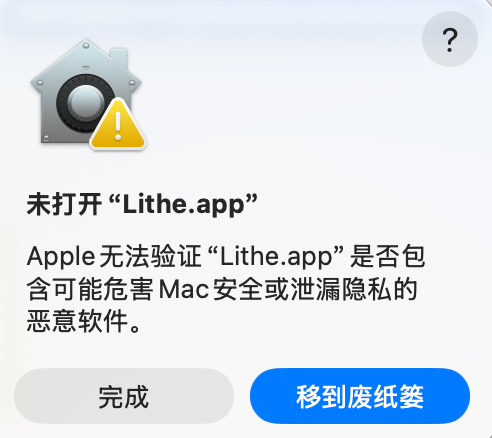
</p>

1. In **Applications**, Control-click `Lithe.app`, choose **Open**, and choose **Open** again in the confirmation dialog.
2. If macOS still blocks it, open **System Settings > Privacy & Security**, click **Open Anyway** next to the security warning, and launch the app again.
3. You can also remove the quarantine attribute in Terminal:

   ```bash
   sudo xattr -dr com.apple.quarantine /Applications/Lithe.app
   ```

Only use these steps for an app whose source you trust. Homebrew installations usually do not require manual quarantine removal.

</details>

## Architecture Overview

The current source uses one Viva desktop workbench and native editor, with a typed Go bridge to Rust Core in its own repository. Platform adapters handle windows, files, processes, terminals, and other system I/O. Core owns shared rules and contracts; the feature matrix tracks migration status. SwiftUI, React/Tauri, and Monaco are no longer this branch's client architecture.

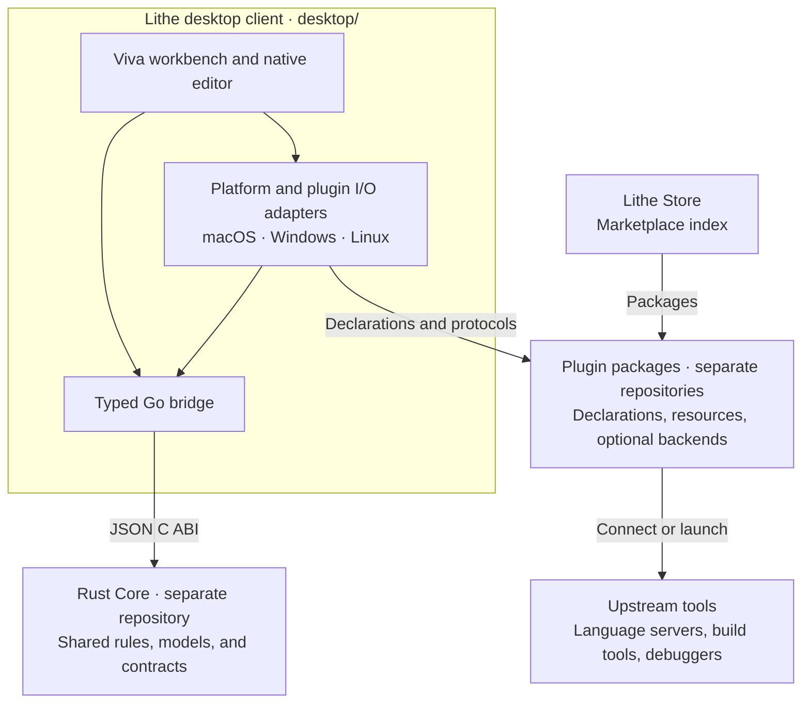

Plugin repositories own their source, translations, resources, and tests. The Rust Core repository owns the [plugin contracts, guides, and SDKs](https://github.com/Lithe-IDEA/Lithe-core-rust/tree/main/shared/plugins). Installed app and plugin packages stay read-only; caches, logs, and working state use platform-writable directories. See [repository ownership and sharing boundaries](./.agents/notes/implemented/architecture/2026-11-08-viva-repository-ownership-and-sharing-boundaries.md) for responsibilities.

<a id="develop-lithe"></a>

<details>
<summary><strong>Develop Lithe</strong></summary>

Use the Go toolchain pinned in `desktop/go.mod`, Rust/Cargo, and the native build dependencies for your platform. macOS needs Xcode Command Line Tools; see [Desktop CI](./.github/workflows/desktop-ci.yml) for Windows and Linux setup. The `replace` in `desktop/go.mod` pins the Viva fork and version.

Start a development build from the repository root:

```bash
./scripts/desktop/desktop-go.sh run ./cmd/lithe
```

This entry point prepares and links the Rust Core revision pinned by the build script. Package the client for the host platform:

```bash
./scripts/desktop/package-desktop.sh
```

Output defaults to `dist/desktop/<os>-<arch>/`. See the [packaging script](./scripts/desktop/package-desktop.sh) for platform formats and options.

Validate the desktop client:

```bash
./scripts/desktop/check.sh
./scripts/desktop/verify/verify-runtime-bundle-immutability.sh
node scripts/i18n/verify-app-language-localization.mjs
node scripts/i18n/generate-i18n.mjs --check
./scripts/platform-feature-matrix/verify-platform-feature-matrix.sh
```

Validate plugin contract and SDK changes in the Rust Core repository, and plugin tests in their own repositories. Read [AGENTS.md](./AGENTS.md) and its development rules before contributing. Include your verification scope and unverified platforms with the change.

</details>


<a id="product-tour"></a>

## Previous client screenshots (archive)

<details>
<summary>View screenshots and demo from the previous macOS client</summary>

These materials show the pre-refactor macOS client, not the current Viva preview or a guarantee of migrated features.

[Previous client demo](https://github.com/user-attachments/assets/17e2325b-afed-4bbb-9926-a962f777269b)

### Git, diffs, and worktrees

Switch projects in one window, review diffs, prepare commits, and inspect and manage Git worktrees.

<p align="center">
  <a href="./docs/assets/screenshots/git-diff-worktrees.png"></a>
</p>

### Search Everywhere and Markdown preview

Double-Shift searches files, symbols, and actions. Edit Markdown alongside its preview and navigate with the table of contents.

<p align="center">
  <a href="./docs/assets/screenshots/search-everywhere-markdown.png"></a>
</p>

### Git history and branches

Browse Git history with a branch list, commit graph, filters, and changed files.

<p align="center">
  <a href="./docs/assets/screenshots/git-history-markdown.png"></a>
</p>

### HTML preview and run services

Edit HTML alongside its preview and browse project entry points and service configurations in the Run panel.

<p align="center">
  <a href="./docs/assets/screenshots/html-preview-run-services.png">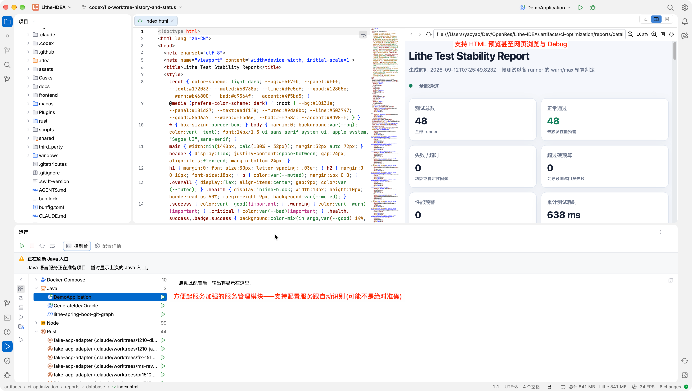</a>
</p>

### Plugin management and native debugging

Manage language, build, and debugger plugins. The screenshot also shows LLDB disassembly and registers.

<p align="center">
  <a href="./docs/assets/screenshots/plugins-native-debugging.png">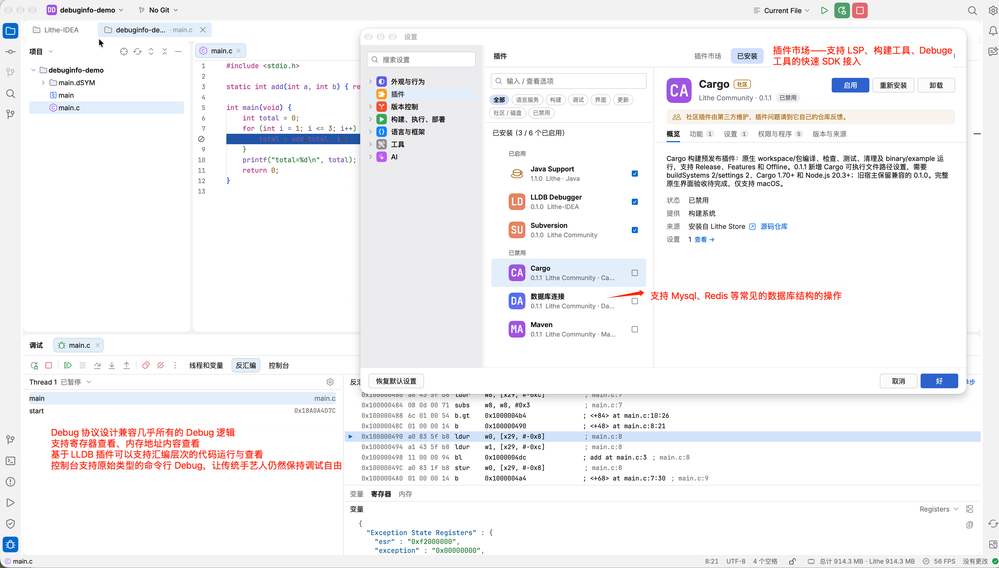</a>
</p>

### AI chat and context

Chat with an agent in the editor area, expand command output, and inspect context usage, file changes, and session statistics.

<p align="center">
  <a href="./docs/assets/screenshots/agent-chat-context.png">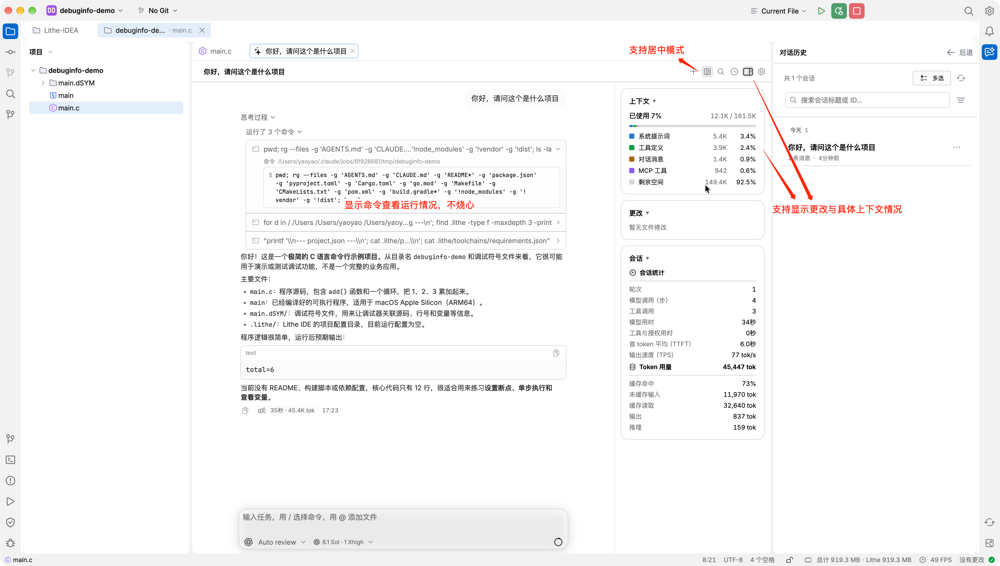</a>
</p>

### Agent resources and MCP configuration

Manage agent instructions, skills, hooks, and MCP configuration, and inspect runtime and token usage in chat.

<p align="center">
  <a href="./docs/assets/screenshots/agent-mcp-settings.png">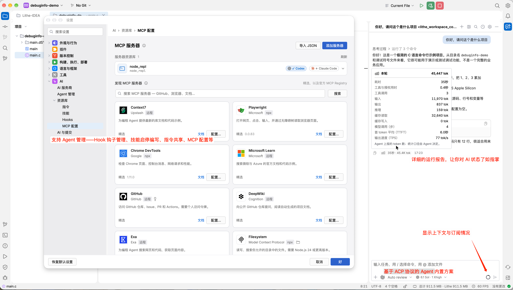</a>
</p>

</details>

## Join the community

Welcome to join the Lithe community, share your experience, ask questions, and follow the latest updates.

<div align="center">
<table>
  <tr>
    <th>QQ group</th>
    <th>WeChat group</th>
  </tr>
  <tr>
    <td align="center"><a href="https://qm.qq.com/cgi-bin/qm/qr?k=&amp;group_code=163027877"></a></td>
    <td align="center"><a href="https://gcnctzuuwe9u.feishu.cn/wiki/HJFbwZ0hZirAPnkWF3xcPWkCnid?from=from_copylink"></a></td>
  </tr>
</table>
</div>

If you cannot scan the WeChat QR code, [click here to join through Feishu](https://gcnctzuuwe9u.feishu.cn/wiki/HJFbwZ0hZirAPnkWF3xcPWkCnid?from=from_copylink).

---

## Project support

### ❤️ Sponsors

<p align="center">
  <a href="https://www.fastaitoken.com/">
    
  </a>
</p>
<p align="center">
  <a href="https://www.fastaitoken.com/"><strong>FastAI</strong></a><br>
  FastAI provides convenient relay access to a range of leading large language models, making it easier to connect AI capabilities to everyday development workflows. Its support helps Lithe continue improving its AI-assisted experience. Thank you to FastAI for supporting this project! Scan the QR code above to join the FastAI Token community chat group #2 (group ID: 1073874006).
</p>

<p align="center">
  <a href="https://pateway.ai/?ch=68i69k">
    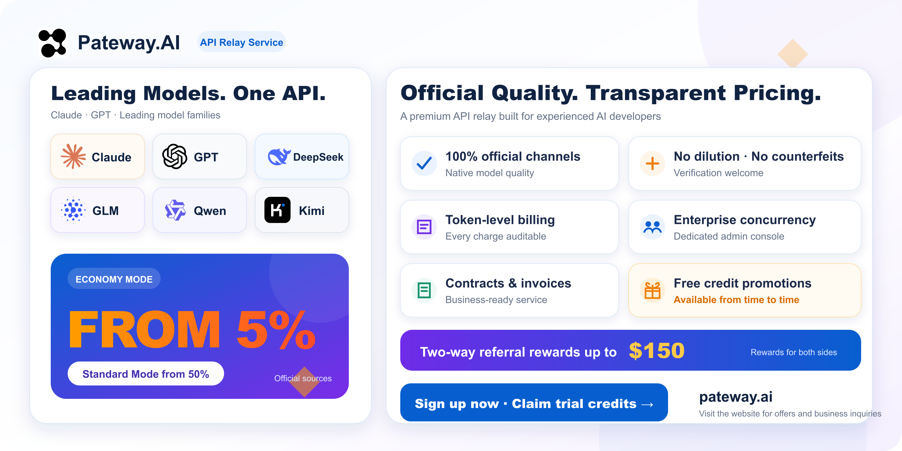
  </a>
</p>
<p align="center">
  Special thanks to PatewayAI for sponsoring this project!<br>
  PatewayAI focuses on premium official-source API relay, supporting Claude, GPT, and leading Chinese models with transparent billing and enterprise-level services.<br>
  Economy mode rates are as low as 5% of official pricing. <a href="https://pateway.ai/?ch=68i69k">Sign up for trial credits</a>, earn free credits in periodic campaigns, and receive mutual referral bonuses of up to $150 USD.
</p>

<p align="center">
  <a href="https://apinebula.ai/ref/8dhC67x0">
    
  </a>
</p>
<p align="center">
  Thanks to APINEBULA for sponsoring this project!<br>
  APINEBULA, an enterprise AI platform under Galaxy Video Bureau, provides access to Claude, GPT, Gemini, and other leading models through one API, with prices starting at 10% of standard rates. It supports high concurrency, formal contracts, corporate bank transfers, and invoicing for AI coding, agent development, and business integrations.<br>
  <a href="https://apinebula.ai/ref/8dhC67x0">Register through this link</a> and enter promo code <strong>Lithe</strong> on your first top-up to get 10% off.
</p>

<a href="mailto:2188718831@qq.com">Want to be featured below?</a>

<table>
  <tr>
    <td width="112" align="center">
      <a href="https://timicc.com">
        
      </a>
    </td>
    <td>
      <a href="https://timicc.com"><strong>TIMI CC</strong></a> is an enterprise AI relay platform focused on stability and service quality, providing fast, reliable model access for leading AI coding tools such as Claude Code and Codex.
    </td>
  </tr>
  <tr>
    <td width="112" align="center">
      <a href="https://torchai.ai/sign-up?aff=FdkE">
        
      </a>
    </td>
    <td>
      <a href="https://torchai.ai/sign-up?aff=FdkE"><strong>TorchAI</strong></a> provides convenient large language model relay access for coding, content, and automation. Thank you to TorchAI for supporting Lithe!
    </td>
  </tr>
  <tr>
    <td width="112" align="center">
      <a href="https://zeusnorun.com/register?ref=AZD4UMG9">
        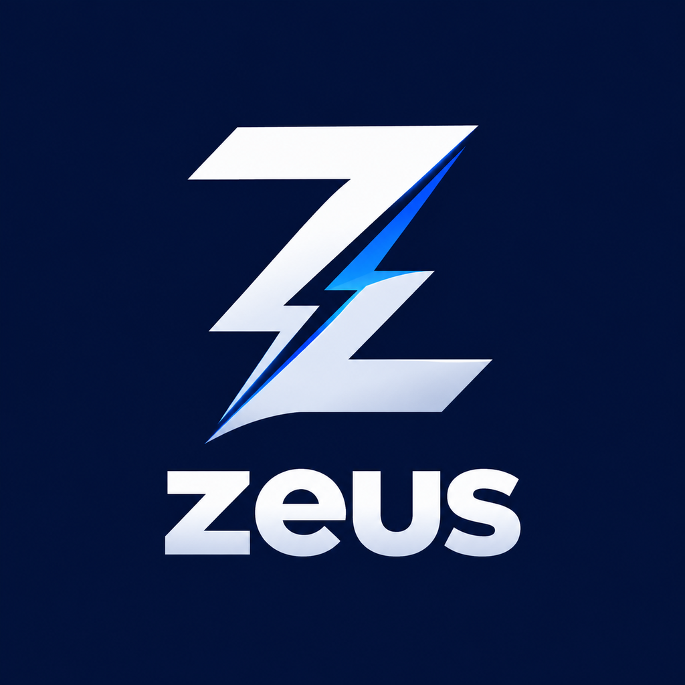
      </a>
    </td>
    <td>
      <a href="https://zeusnorun.com/register?ref=AZD4UMG9"><strong>Zeus</strong></a> provides GPT, Claude, Grok, and GPT Image relay access at rates as low as 0.08×, with invoicing and corporate payment support.
    </td>
  </tr>
  <tr>
    <td width="112" align="center">
      <a href="https://dash.clidex.dev">
        
      </a>
    </td>
    <td>
      <a href="https://dash.clidex.dev"><strong>Clidex</strong></a> provides AI infrastructure and API access for native AI command-line tools at just 0.8% of official pricing. Thank you to Clidex for supporting Lithe!
    </td>
  </tr>
  <tr>
    <td width="112" align="center">
      <a href="https://www.atlascloud.ai/zh">
        
      </a>
    </td>
    <td>
      <a href="https://www.atlascloud.ai/zh"><strong>Atlas Cloud</strong></a> provides AI model relay services with access to <strong>over 400 models</strong>, giving developers more options through one platform. Thank you to Atlas Cloud for supporting Lithe!
    </td>
  </tr>
  <tr>
    <td width="112" align="center">
      <a href="https://www.compshare.cn?ytag=GPU_YY_YX_git_litheidea">
        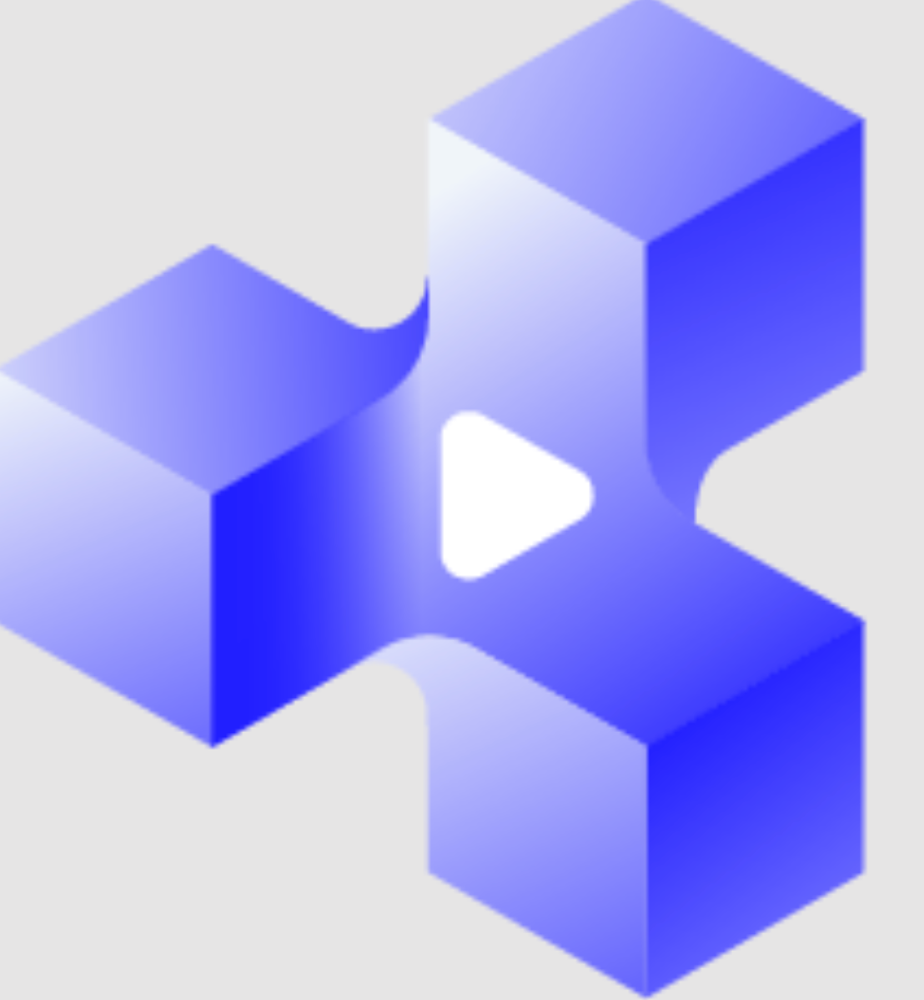
      </a>
    </td>
    <td>
      <a href="https://www.compshare.cn?ytag=GPU_YY_YX_git_litheidea"><strong>优云智算 Compshare</strong></a> UCloud’s AI cloud platform provides GPU computing and monthly or pay-per-use Coding Plans for Chinese AI models, with Claude Code, Codex, and API access. Its H3 video generation plans support up to 2K resolution and 30-second videos, starting at ¥0.08 per second. Enterprise concurrency, 24/7 technical support, and self-service invoicing are available.
    </td>
  </tr>
  <tr>
    <td width="112" align="center">
      <a href="https://codezsy.com/register?aff=fDyA">
        
      </a>
    </td>
    <td>
      <a href="https://codezsy.com/register?aff=fDyA"><strong>CodeZ</strong></a> provides stable relay access to GPT-family models for integrating model APIs into tools and projects. Thank you to CodeZ for supporting Lithe!
    </td>
  </tr>
</table>

### ⭐ Special thanks

<p align="center">
  <a href="https://linux.do/">
    
  </a>
</p>

<p align="center">
  <strong>For all things AI, head to <a href="https://linux.do/">LINUX DO</a>. Wishing the community ever greater success.</strong>
</p>

### Contributors

Thank you to everyone who contributes to and improves Lithe.

<a href="https://github.com/1lck/Lithe-IDEA/graphs/contributors">
  
</a>

### License

Lithe is licensed under the [Apache License 2.0](./LICENSE).

## Star History

<a href="https://www.star-history.com/#1lck/Lithe-IDEA&Date">
  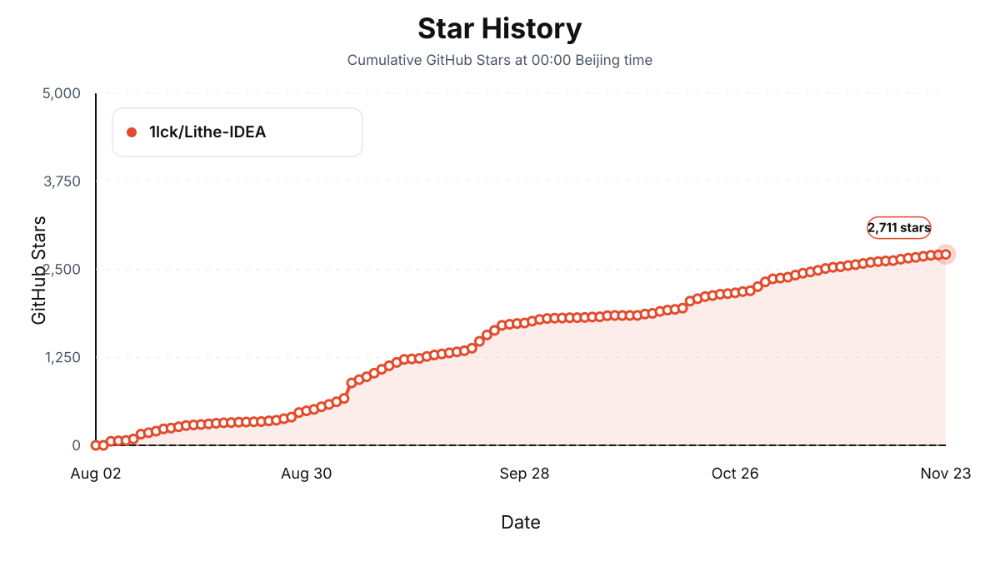
</a>
