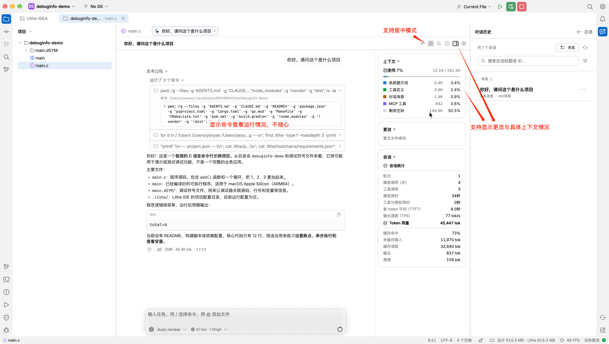
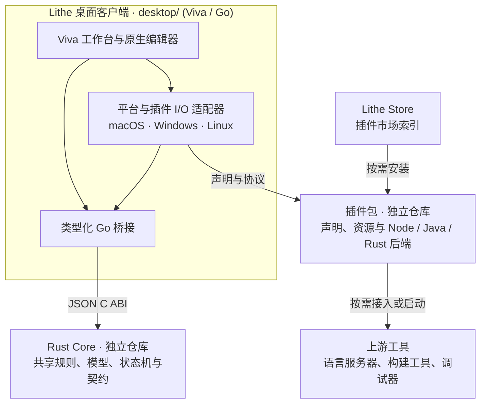
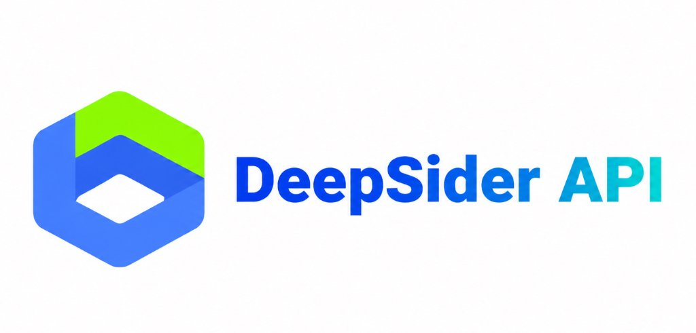

<div align="center">
  

  <h1>Lithe</h1>

  <p><strong>极致轻量、低延迟、可插拔的跨平台原生 IDE —— 基于 Rust Core 与 Viva (Go) 打造</strong></p>

  <p>
    <a href="./README.md"><strong>English</strong></a> ·
    <a href="#性能基准测试">性能基准</a> ·
    <a href="#下载与安装">下载与安装</a> ·
    <a href="https://github.com/Lithe-IDEA/Lithe-store">插件市场</a> ·
    <a href="https://github.com/Lithe-IDEA/Lithe-core-rust/tree/main/shared/plugins">插件开发</a>
  </p>

  <p>
    <a href="https://hellogithub.com/repository/1lck/Lithe-IDEA" target="_blank"></a>
    <a href="https://trendshift.io/repositories/124763?utm_source=repository-badge&amp;utm_medium=badge&amp;utm_campaign=badge-repository-124763" target="_blank" rel="noopener noreferrer"></a>
    <a href="https://atomgit.com/lithe_IDEA/Lithe-IDEA"></a>
  </p>

  <p>
    <a href="https://github.com/1lck/Lithe-IDEA/releases/latest"></a>
    <a href="https://github.com/1lck/Lithe-IDEA/releases"></a>
    
    
    
    <a href="#下载与安装"></a>
    <a href="./LICENSE"></a>
  </p>
</div>

https://github.com/user-attachments/assets/17e2325b-afed-4bbb-9926-a962f777269b

## 欢迎加入群聊

欢迎加入 Lithe 社区，分享使用体验、交流性能与插件开发，获取项目最新动态。

<div align="center">
<table>
  <tr>
    <th>QQ群</th>
    <th>微信群</th>
  </tr>
  <tr>
    <td align="center"><a href="https://qm.qq.com/cgi-bin/qm/qr?k=&amp;group_code=163027877"></a></td>
    <td align="center"><a href="https://gcnctzuuwe9u.feishu.cn/wiki/HJFbwZ0hZirAPnkWF3xcPWkCnid?from=from_copylink"></a></td>
  </tr>
</table>
</div>

如果无法扫描微信群二维码，[点击这里通过飞书加入群聊](https://gcnctzuuwe9u.feishu.cn/wiki/HJFbwZ0hZirAPnkWF3xcPWkCnid?from=from_copylink)。

## 关于 Lithe

> **AI 负责编写代码，Lithe 帮你理解工程、运行调试并审查每一处修改。**

Lithe 是一款基于 **Viva（Go 原生工作台）+ Rust Core** 重构的插件化、可插拔跨平台原生 IDE。本体告别 Electron / WebView 的沉重开销，将启动时间压到 **1 秒内**、空闲内存控制在 **171 MB**；语言智能、构建、运行与调试能力全部通过独立插件按需插拔接入，随用随装、闲置零负担。

| 核心能力 | 说明 |
| --- | --- |
| **原生编辑与搜索** | 高性能原生编辑器、项目树、标签页与全局搜索（文件 / 符号 / 操作）。 |
| **Git 深度审查** | 变更列表、Diff 对比、提交、分支历史与原生 Worktree 多工作树管理。 |
| **按需语言、构建与调试** | 通过独立插件按需接入 LSP、构建任务与调试器（DAP / 原生），闲置零后台空转。 |
| **AI Agent 与插件生态** | 内置 Agent 对话、MCP 与资源监控；支持 Node / Java / Rust 多语言插件后端（[Lithe Store](https://github.com/Lithe-IDEA/Lithe-store)）。 |

> 跨平台功能完成度见 [功能矩阵与决策看板](https://1lck.github.io/Lithe-IDEA/)。

---

## 性能基准测试

### 第一层：冷启动与空闲占用

| 编辑器 | 项目窗口出现 | 启动到空闲 | 稳定内存 | 峰值内存 | 空闲 CPU | 累计 CPU 时间 | 进程 / 线程 |
| --- | --- | --- | --- | --- | --- | --- | --- |
| **Lithe 0.7.0** | 0.67 s | **0.97 s** | **171 MB** | **246 MB** | **0.01%** | **1.9 s** | 4 / 31 |
| GoLand 2026.2.4 | 2.27 s | 9.77 s | 2658 MB | 2954 MB | 7.11% | 56.4 s | 9 / 259 |
| VS Code 1.146.0 | 1.27 s | 4.58 s | 697 MB | 1383 MB | 0.86% | 10.1 s | 12 / 232 |
| Zed 1.28.1 | **0.51 s** | 1.43 s | 188 MB | 274 MB | 0.58% | 2.3 s | 3 / 30 |

### 第二层：真实工程交互延迟（`Lithe-IDEA` 仓库 `app.go`，每项 5 轮，中位数）

| 项目 | Lithe | Zed | GoLand |
| --- | --- | --- | --- |
| 打开到就绪 | 8.31 s | 6.59 s | 26.0 s |
| 跳到定义（首次响应 / 画面稳定） | 61 / **78 ms** | 62 / 149 ms | 79 / 165 ms |
| 悬停 | 552 ms | 382 ms | 569 ms |
| 悬停，扣掉编辑器自带的等待 | **52 ms**（等 500 ms） | 82 ms（等 300 ms） | 69 ms（等约 500 ms） |
| 查找引用（首次响应 / 画面稳定） | 78 / **94 ms** | 63 / 113 ms | 82 / 1365 ms |
| 打字（输入 / 退格） | **32 / 46 ms** | 64 / 64 ms | 62 / 64 ms |
| 测试期间峰值内存 / 累计 CPU | 2163 MB / **62.5 s** | 2119 MB / 71.5 s | 4540 MB / 524.3 s |

---

## 下载与安装

从 `0.8.1` 起，发行版提供基于 Viva + Rust Core 的统一桌面客户端 `Lithe Desktop.app`（支持应用内自动增量更新）：

- **macOS 13+（推荐 Homebrew）：**

  ```bash
  brew tap lithe-idea/lithe https://github.com/1lck/Lithe-IDEA.git
  brew install --cask lithe-idea/lithe/lithe
  brew upgrade --cask lithe
  ```

  <details>
  <summary>早先从旧地址添加过 Homebrew tap？点此查看迁移命令</summary>

  早先的 tap 地址 `https://github.com/Lithe-IDEA/Lithe-IDEA.git` 已归档（停在 `0.6.1`）。升级前请先将 tap 指向本仓库：

  ```bash
  brew tap --custom-remote lithe-idea/lithe https://github.com/1lck/Lithe-IDEA.git
  brew upgrade --cask lithe
  ```

  从 `0.6.x` 升级时会自动将旧的 `Lithe.app` 替换为 `Lithe Desktop.app`。

  </details>

- **macOS 手动安装：** 前往 [GitHub Releases](https://github.com/1lck/Lithe-IDEA/releases/latest) 下载 `.dmg`（Apple Silicon 选 `arm64`，Intel 选 `amd64`）。
- **Windows x64：** 前往 [GitHub Releases](https://github.com/1lck/Lithe-IDEA/releases/latest) 下载 Windows `.exe` 安装包。
- **Linux x64 / arm64：** 一行命令为当前用户安装（不用 `sudo`）。脚本从更新源下载发行包并校验 SHA-256，把 `lithe` 放进 `~/.local/bin`，并加入应用程序菜单；之后 Lithe 会自动增量更新：

  ```bash
  curl -fsSL https://raw.githubusercontent.com/1lck/Lithe-IDEA/main/scripts/install/linux.sh | sh
  curl -fsSL https://raw.githubusercontent.com/1lck/Lithe-IDEA/main/scripts/install/linux.sh | sh -s -- uninstall
  ```

  [GitHub Releases](https://github.com/1lck/Lithe-IDEA/releases) 里的 `.deb`、`.rpm` 由包管理器管理，不会自动更新。也可以手动解压 Linux 的 `.tar.gz`，运行其中的 `./install.sh`。
- **源码运行 / 预发布构建：** 查看 [Releases](https://github.com/1lck/Lithe-IDEA/releases) 中的版本说明，或通过下方 [如何开发](#如何开发) 直接从源码构建运行。

<details>
<summary><strong>macOS 首次打开提示“无法验证/无法打开 Lithe”怎么办？</strong></summary>

手动下载或临时签名（ad hoc）的 AutoBuild 安装包尚未经过 Apple 公证时，macOS 可能会拦截首次启动。请先确认安装包来自官方 [GitHub Releases](https://github.com/1lck/Lithe-IDEA/releases)，然后任选以下一种方式放行：

<p align="center">
  
</p>

1. 在“应用程序”中按住 `Control` 键点按 `Lithe Desktop.app`（或旧版 `Lithe.app`），选择 **打开**，在确认弹窗中再次点击 **打开**。
2. 打开 **系统设置 > 隐私与安全性**，在安全性提示旁点击 **仍要打开**，随后重新启动应用。
3. 在终端移除隔离标记（仅用于确认来源可靠的应用；通过 Homebrew 安装通常无需此步骤）：

   ```bash
   xattr -dr com.apple.quarantine "/Applications/Lithe Desktop.app"
   ```

</details>

---

## 界面与工作流参考

以下截图展示了 Lithe 核心工作流设计（部分截图来自早期 macOS 客户端，供工作流参考；点击图片可查看原图）：

### Git、Diff 与多 Worktree 管理

在同一窗口切换项目、审查 Diff、编写提交信息，并直观管理多个 Git Worktree。

<p align="center">
  <a href="./docs/assets/screenshots/git-diff-worktrees.png"></a>
</p>

### 全局搜索与 Markdown 预览

双击 `Shift` 搜索文件、符号与操作；Markdown 支持双栏编辑、实时预览与大纲导航。

<p align="center">
  <a href="./docs/assets/screenshots/search-everywhere-markdown.png"></a>
</p>

<details>
<summary>更多工作流截图（Git 历史 / 运行服务 / 原生调试 / AI 对话与 MCP）</summary>

### Git 历史与分支浏览

结合分支列表、提交图、筛选器和变更文件浏览 Git 历史。

<p align="center">
  <a href="./docs/assets/screenshots/git-history-markdown.png"></a>
</p>

### HTML 预览与运行服务

并排编辑和预览 HTML，在运行面板中查看项目入口与服务配置。

<p align="center">
  <a href="./docs/assets/screenshots/html-preview-run-services.png"></a>
</p>

### 插件管理与原生调试

管理语言服务、构建和调试插件；图中同时展示 LLDB 反汇编与寄存器视图。

<p align="center">
  <a href="./docs/assets/screenshots/plugins-native-debugging.png"></a>
</p>

### AI 对话与上下文

在编辑区中与 Agent 对话，展开命令执行记录，查看上下文用量、文件更改和会话统计。

<p align="center">
  <a href="./docs/assets/screenshots/agent-chat-context.png"></a>
</p>

### Agent 资源与 MCP 配置

集中管理 Agent 的指令、技能、Hooks 和 MCP 配置，在对话中查看运行耗时与 Token 用量。

<p align="center">
  <a href="./docs/assets/screenshots/agent-mcp-settings.png"></a>
</p>

</details>

---

<a id="如何开发"></a>

## 如何开发

<details>
<summary><strong>架构概览、从源码构建与验证（macOS / Windows / Linux）</strong></summary>

### 架构概览

Lithe 采用**共享核心 + 原生呈现**双层架构：**Viva（`desktop/`，Go）**负责跨平台窗口、原生编辑渲染与系统 I/O；**[Rust Core](https://github.com/Lithe-IDEA/Lithe-core-rust)** 持有全部共享规则与状态机并通过 JSON C ABI 暴露给桌面端；插件代码与[契约/SDK](https://github.com/Lithe-IDEA/Lithe-core-rust/tree/main/shared/plugins)独立维护，安装包运行时保持只读以支持安全增量更新。



### 构建与验证

构建需要 `desktop/go.mod` 固定的 Go 工具链、Rust/Cargo 以及当前平台的原生构建依赖（macOS 需要 Xcode Command Line Tools；Windows 与 Linux 环境配置可参考 [Desktop CI](./.github/workflows/desktop-ci.yml)）。Viva 的固定版本由 `desktop/go.mod` 的 `replace` 指定。

从仓库根目录启动开发版本（脚本会自动准备并链接固定版本的 Rust Core）：

```bash
./scripts/desktop/desktop-go.sh run ./cmd/lithe
```

构建本机安装包（默认输出到 `dist/desktop/<os>-<arch>/`）：

```bash
./scripts/desktop/package-desktop.sh
```

运行桌面客户端与仓库校验：

```bash
./scripts/desktop/check.sh
./scripts/desktop/verify/verify-runtime-bundle-immutability.sh
node scripts/i18n/verify-app-language-localization.mjs
node scripts/i18n/generate-i18n.mjs --check
./scripts/platform-feature-matrix/verify-platform-feature-matrix.sh
```

- 插件契约与 SDK 改动请在 [Lithe-core-rust](https://github.com/Lithe-IDEA/Lithe-core-rust) 仓库验证；插件业务与测试请在对应插件仓库运行。
- 贡献代码前请先阅读 [AGENTS.md](./AGENTS.md) 与其中的开发规范，并在 PR 中说明验证范围与平台状态。

</details>

---

## 项目支持

### ❤️ 赞助商

<p align="center">
  <a href="https://www.fastaitoken.com/">
    
  </a>
</p>
<p align="center">
  <a href="https://www.fastaitoken.com/"><strong>FastAI</strong></a><br>
  FastAI 提供多款主流大模型的便捷中转服务，让开发者可以更轻松地把 AI 能力接入日常开发流程。其支持也帮助 Lithe 持续完善 AI 辅助体验。感谢 FastAI 对本项目的支持！欢迎扫码加入 FastAI Token 交流群②（群号：1073874006）。
</p>

<p align="center">
  <a href="https://pateway.ai/?ch=68i69k">
    
  </a>
</p>
<p align="center">
  感谢 PatewayAI 对本项目的赞助！<br>
  PatewayAI 专注于官方高质量模型 API 中继，完整支持 Claude、GPT 系列以及各类国内主流模型，并提供透明计费与企业级服务。<br>
  经济模式低至 0.5 折！<a href="https://pateway.ai/?ch=68i69k">通过此链接注册可获试用额度</a>，还可参与不定时活动领取免费额度，双向推荐奖励最高达 150 美元。
</p>

<p align="center">
  <a href="https://apinebula.ai/ref/8dhC67x0">
    
  </a>
</p>
<p align="center">
  感谢 APINEBULA 赞助本项目！<br>
  APINEBULA 是银河录像局旗下的企业级 AI 聚合平台，通过一个 API 接入 Claude、GPT、Gemini 等主流模型，价格低至 1 折，支持高并发、正式合同、对公打款与开票，适用于 AI 编程、Agent 开发和业务系统集成。<br>
  <a href="https://apinebula.ai/ref/8dhC67x0">通过此链接注册</a>，首次充值时填写优惠码 <strong>Lithe</strong>，可享九折优惠。
</p>

<a href="mailto:2188718831@qq.com">想显示在下方？</a>

<table>
  <tr>
    <td width="112" align="center">
      <a href="https://timicc.com">
        
      </a>
    </td>
    <td>
      <a href="https://timicc.com"><strong>TIMI CC</strong></a> 是企业级 AI 中继平台，专注于稳定性与优质服务，为 Claude Code、Codex 等主流 AI 编程工具提供快速、稳定、高质量的模型接入服务。
    </td>
  </tr>
  <tr>
    <td width="112" align="center">
      <a href="https://www.deepsiderapi.com/?utm_source=lithe">
        
      </a>
    </td>
    <td>
      <a href="https://www.deepsiderapi.com/?utm_source=lithe"><strong>DeepSider API</strong></a> 一站式接入 GPT、Claude、Gemini、DeepSeek 等全球主流模型。采用大厂官方渠道，非号池、非逆向。调用价格低至官方定价 2.9 折。支持实时用量监控，消费透明、用量清晰，助你以更低成本轻松调用 AI。
    </td>
  </tr>
  <tr>
    <td width="112" align="center">
      <a href="https://zeusnorun.com/register?ref=AZD4UMG9">
        
      </a>
    </td>
    <td>
      <a href="https://zeusnorun.com/register?ref=AZD4UMG9"><strong>Zeus 宙斯中转站</strong></a> 提供 GPT、Claude、Grok 及 GPT Image 中转服务，最低 0.08 倍率，支持开票与对公付款。
    </td>
  </tr>
  <tr>
    <td width="112" align="center">
      <a href="https://dash.clidex.dev">
        
      </a>
    </td>
    <td>
      <a href="https://dash.clidex.dev"><strong>Clidex</strong></a> 提供 AI 基础设施和原生 AI 命令行工具 API 接入，价格低至官方 API 的 0.08 折。感谢 Clidex 对 Lithe 的支持！
    </td>
  </tr>
  <tr>
    <td width="112" align="center">
      <a href="https://www.atlascloud.ai/zh">
        
      </a>
    </td>
    <td>
      <a href="https://www.atlascloud.ai/zh"><strong>Atlas Cloud</strong></a> 提供 <strong>400 多种模型</strong>的 AI 中转服务，开发者可以在同一平台探索和比较模型。感谢 Atlas Cloud 对 Lithe 的支持！
    </td>
  </tr>
  <tr>
    <td width="112" align="center">
      <a href="https://www.compshare.cn?ytag=GPU_YY_YX_git_litheidea">
        
      </a>
    </td>
    <td>
      <a href="https://www.compshare.cn?ytag=GPU_YY_YX_git_litheidea"><strong>优云智算 Compshare</strong></a> UCloud 旗下 AI 云平台，提供 GPU 算力及包月、按次的国模 Coding Plan，支持 Claude Code、Codex 和 API 接入。H3 视频生成套餐低至 0.08 元/秒，支持 2K 分辨率及最长 30 秒视频；支持企业高并发、7×24 技术支持和自助开票。
    </td>
  </tr>
  <tr>
    <td width="112" align="center">
      <a href="https://codezsy.com/register?aff=fDyA">
        
      </a>
    </td>
    <td>
      <a href="https://codezsy.com/register?aff=fDyA"><strong>CodeZ</strong></a> 专注于 GPT 系列模型的稳定中转，为开发者集成模型 API 提供直接选择。感谢 CodeZ 对 Lithe 的支持！
    </td>
  </tr>
</table>

### ⭐ 特别鸣谢

<p align="center">
  <a href="https://linux.do/">
    
  </a>
</p>

<p align="center">
  <strong>关于 AI 的一切，欢迎前往 <a href="https://linux.do/">LINUX DO</a>！祝社区越来越好～</strong>
</p>

### 贡献者

感谢所有参与 Lithe 开发和改进的贡献者。

<a href="https://github.com/1lck/Lithe-IDEA/graphs/contributors">
  
</a>

### License

Lithe 采用 [Apache License 2.0](./LICENSE) 授权。
