<div align="center">
  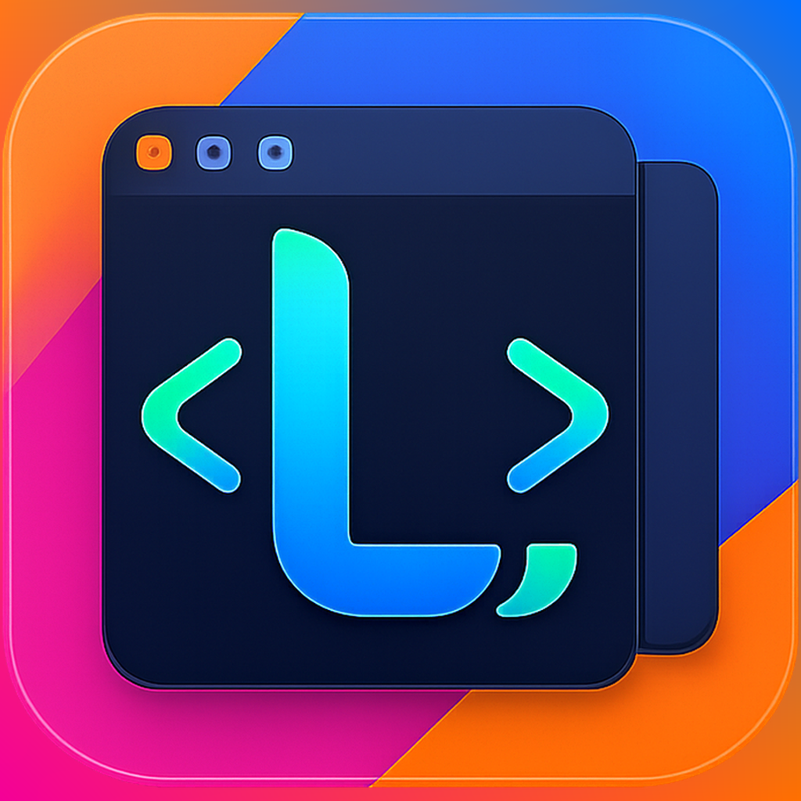

  <h1>Lithe</h1>

  <p><strong>轻量、通用、跨平台的插件化 IDE，按需灵活配置</strong></p>

  <p>
    <a href="./README.md"><strong>English</strong></a> ·
    <a href="#performance-benchmarks">性能实测</a> ·
    <a href="#核心功能">核心功能</a> ·
    <a href="#下载与安装">下载</a> ·
    <a href="https://github.com/Lithe-IDEA/Lithe-store">插件市场</a> ·
    <a href="https://github.com/Lithe-IDEA/Lithe-core-rust/tree/main/shared/plugins">插件开发</a> ·
    <a href="https://1lck.github.io/Lithe-IDEA/">工程决策看板</a> ·
    <a href="#如何开发">如何开发</a>
  </p>

  <p>
    <a href="https://hellogithub.com/repository/1lck/Lithe-IDEA" target="_blank"></a>
    <a href="https://trendshift.io/repositories/124763?utm_source=repository-badge&amp;utm_medium=badge&amp;utm_campaign=badge-repository-124763" target="_blank" rel="noopener noreferrer"></a>
    <a href="https://atomgit.com/lithe_IDEA/Lithe-IDEA"></a>
  </p>

  <p>
    <a href="https://github.com/1lck/Lithe-IDEA/releases/latest"></a>
    <a href="https://github.com/1lck/Lithe-IDEA/releases"></a>
    
    
    <a href="#下载与安装"></a>
    <a href="./LICENSE"></a>
  </p>
</div>

## 为什么做 Lithe

AI 编程工具可以一次修改许多文件。审查这些修改时，开发者仍然需要理解项目、跳转符号、运行和调试代码，并检查每一处 Diff。Lithe 把这些工作流放进同一个工作台，再通过插件接入项目需要的工具。

## Lithe 是什么

Lithe 是一款以低资源占用为目标、通过插件扩展的通用 IDE。它把项目浏览、代码编辑、搜索、Git 审查和终端放在同一个工作台中；语言智能、构建、运行和调试能力由安装的插件接入。

当前 `preview` 分支正在开发基于 **Viva（Go）与 Rust Core** 的统一桌面客户端。macOS、Windows 和 Linux 共用工作台代码，系统集成由各平台适配器完成。功能迁移和平台验收仍在进行，完成度见[功能矩阵与决策看板](https://1lck.github.io/Lithe-IDEA/)，不能把旧版功能列表视为新版的完整支持承诺。

语言服务器、插件后端、构建工具和调试器按需启动。内存占用取决于项目大小、打开的内容及启用的插件；旧客户端的测量数字不代表当前预览版。

> **AI 负责编写代码，Lithe 帮你理解项目、运行程序并审查修改。**

<a id="performance-benchmarks"></a>

## 性能实测

**关键数据：**启动到空闲 **0.97 秒**、稳定内存 **171 MB**（Lithe 0.7.0 启动测试）；跳转定义画面稳定 **78 毫秒**、查找引用画面稳定 **94 毫秒**（另一组交互测试）。

### 启动与资源占用

| 编辑器（测试版本） | 项目窗口出现 | 启动到空闲 | 稳定内存 | 峰值内存 |
| --- | ---: | ---: | ---: | ---: |
| **Lithe 0.7.0** | **0.67 s** | **0.97 s** | **171 MB** | **246 MB** |
| GoLand 2026.2.4 | 2.27 s | 9.77 s | 2658 MB | 2954 MB |
| VS Code 1.146.0 | 1.27 s | 4.58 s | 697 MB | 1383 MB |
| Zed 1.28.1 | 0.51 s | 1.43 s | 188 MB | 274 MB |

<details>
<summary>展开其他资源指标：空闲 CPU、累计 CPU 时间、进程与线程</summary>

| 编辑器 | 空闲 CPU | 累计 CPU 时间 | 进程 / 线程 |
| --- | ---: | ---: | ---: |
| **Lithe** | **0.01%** | **1.9 s** | **4 / 31** |
| GoLand | 7.11% | 56.4 s | 9 / 259 |
| VS Code | 0.86% | 10.1 s | 12 / 232 |
| Zed | 0.58% | 2.3 s | 3 / 30 |

</details>

### 交互延迟

测试项目为 **Lithe-IDEA 仓库**，操作文件为 `app.go`；**每项测量 5 轮，取中位数**。两段时间分别表示**首次响应 / 画面稳定**。

| 项目 | Lithe | Zed | GoLand |
| --- | ---: | ---: | ---: |
| 打开项目到就绪 | 8.31 s | 6.59 s | 26.0 s |
| 跳转定义（首次响应 / 画面稳定） | **61 / 78 ms** | 62 / 149 ms | 79 / 165 ms |
| 悬停 | 552 ms | **382 ms** | 569 ms |
| 悬停，扣除编辑器自带等待 | **52 ms**（等 500 ms） | 82 ms（等 300 ms） | 69 ms（等约 500 ms） |
| 查找引用（首次响应 / 画面稳定） | 78 / **94 ms** | **63** / 113 ms | 82 / 1365 ms |
| 打字（输入 / 退格） | **32 / 46 ms** | 64 / 64 ms | 62 / 64 ms |
| 测试期间峰值内存 / 累计 CPU | 2163 MB / 62.5 s | 2119 MB / 71.5 s | 4540 MB / 524.3 s |

*数据来自维护者提供的测试截图。启动与交互使用不同负载，峰值内存不可混用；交互截图没有注明各编辑器版本。各编辑器悬停等待时间也不相同。原截图未注明硬件、操作系统、采集工具和测试日期，因此这些数字是测试快照，不代表跨设备的标准化结论。已发布安装包也可能与本 `preview` 分支使用不同客户端。*

## 核心功能

| 工作流 | 职责与入口 |
| --- | --- |
| 项目与编辑 | 项目树、文件标签、原生编辑器，以及文件、符号和操作搜索。 |
| Git 审查 | 变更、Diff、提交、分支、历史和工作树管理。 |
| 语言智能 | 通过插件接入语言服务器，提供补全、诊断、导航等语言能力。 |
| 构建、运行与调试 | 插件声明项目模型、任务和调试提供者，工作台提供统一入口、输出和调试视图。 |
| 插件管理 | 从市场或本地安装插件，查看权限与程序声明，启用、停用和管理插件。 |
| AI 与资源 | 在工作台中使用 Agent 对话与上下文工具，查看应用和相关进程的资源占用。 |

以上是当前工作台的功能分工，具体可用性取决于平台、构建版本和安装的插件。插件自身的工具要求与功能范围以其仓库和市场说明为准。

## 下载与安装

当前分支的 Viva 客户端仍在迁移中；已发布的稳定版和 AutoBuild 可能来自旧客户端。请先查看 [Releases 中的版本说明](https://github.com/1lck/Lithe-IDEA/releases)，确认客户端架构、平台和插件兼容性。Homebrew 跟随已发布版本，不代表当前 `preview` 源码；需要运行当前源码时，使用下方开发入口。

- **macOS 13+：**前往 [GitHub Releases](https://github.com/1lck/Lithe-IDEA/releases/latest) 下载 `.dmg`。M 系列芯片选择 `arm64`，Intel 芯片选择 `x86_64`。
- **Windows x64：**前往 [GitHub Releases](https://github.com/1lck/Lithe-IDEA/releases/latest) 下载 Windows `.exe` 安装包。

macOS 推荐使用 Homebrew 安装和更新：

```bash
brew tap lithe-idea/lithe https://github.com/Lithe-IDEA/Lithe-IDEA.git
brew install --cask lithe-idea/lithe/lithe
brew upgrade --cask lithe
```

<details>
<summary>macOS 安装排障：提示无法打开 Lithe.app</summary>

如果 macOS 提示“Apple 无法验证 Lithe.app 是否包含可能危害 Mac 安全或泄漏隐私的恶意软件”，通常是因为手动下载的安装包尚未经过 Apple 公证。请先确认应用来自可信的 [GitHub Releases](https://github.com/1lck/Lithe-IDEA/releases/latest)，然后选择以下任一方式：

<p align="center">
  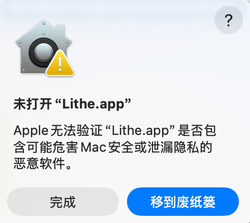
</p>

1. 在“应用程序”中按住 Control 键点按 `Lithe.app`，选择“打开”，再在确认对话框中选择“打开”。
2. 如果仍被阻止，打开“系统设置 > 隐私与安全性”，在安全性提示旁点按“仍要打开”，然后再次启动应用。
3. 也可以在终端中移除下载文件的隔离标记：

   ```bash
   sudo xattr -dr com.apple.quarantine /Applications/Lithe.app
   ```

上述命令只应对你确认来源可靠的应用使用；通过 Homebrew 安装通常不需要手动执行这些步骤。

</details>

## 架构概览

当前源码使用一套 Viva 桌面工作台和原生编辑器，通过类型化 Go 桥接调用独立仓库中的 Rust Core。平台适配器负责窗口、文件、进程、终端和其他系统 I/O；共享规则与契约由 Core 持有，迁移状态以功能矩阵为准。旧的 SwiftUI、React/Tauri 和 Monaco 客户端不再是本分支的架构。

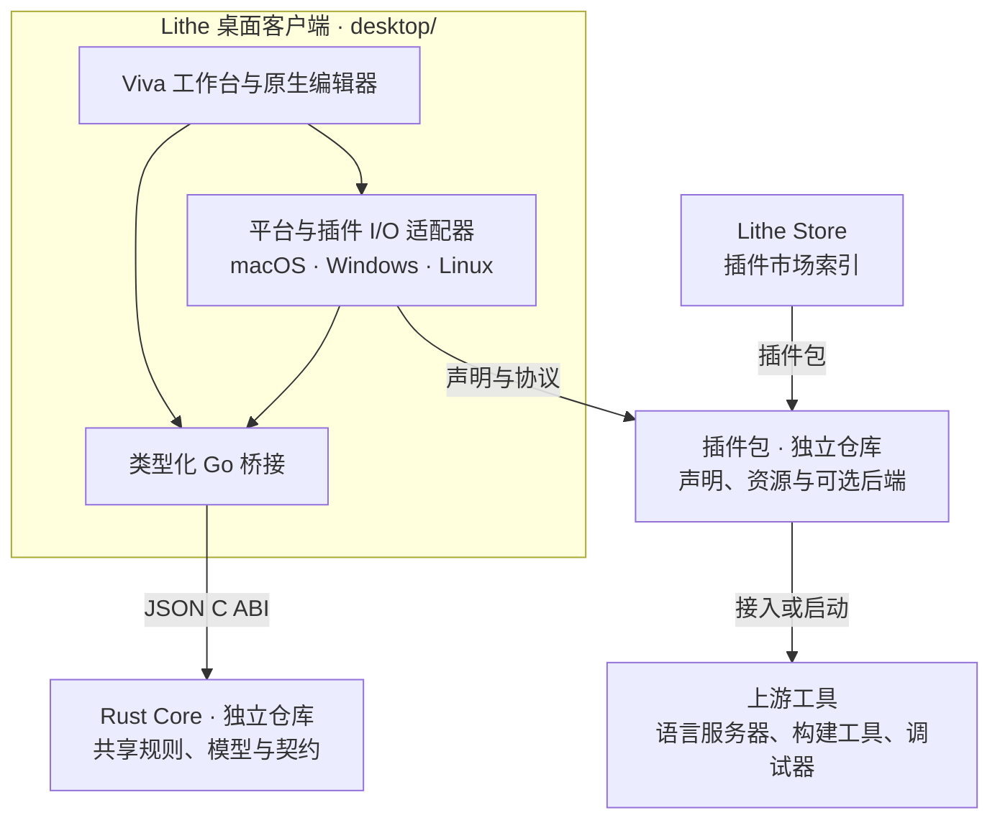

插件源码、翻译、资源与测试由插件仓库维护；[插件契约、指南和 SDK](https://github.com/Lithe-IDEA/Lithe-core-rust/tree/main/shared/plugins)统一在 Rust Core 仓库维护。安装后的应用与插件包保持只读，缓存、日志和工作状态写入平台可写目录。职责边界见[仓库所有权与共享边界](./.agents/notes/implemented/architecture/2026-11-08-viva-repository-ownership-and-sharing-boundaries.md)。

<a id="如何开发"></a>

<details>
<summary><strong>如何开发</strong></summary>

使用 `desktop/go.mod` 固定的 Go 工具链、Rust/Cargo 和当前平台的原生构建依赖。macOS 需要 Xcode Command Line Tools；Windows、Linux 的环境配置可参考 [Desktop CI](./.github/workflows/desktop-ci.yml)。Viva 的固定版本与 fork 由 `desktop/go.mod` 的 `replace` 决定。

从仓库根目录启动开发版本：

```bash
./scripts/desktop/desktop-go.sh run ./cmd/lithe
```

这个入口会准备并链接构建脚本固定的 Rust Core。构建本机安装包：

```bash
./scripts/desktop/package-desktop.sh
```

输出默认位于 `dist/desktop/<os>-<arch>/`。平台格式与可选参数见[打包脚本](./scripts/desktop/package-desktop.sh)。

验证桌面客户端：

```bash
./scripts/desktop/check.sh
./scripts/desktop/verify/verify-runtime-bundle-immutability.sh
node scripts/i18n/verify-app-language-localization.mjs
node scripts/i18n/generate-i18n.mjs --check
./scripts/platform-feature-matrix/verify-platform-feature-matrix.sh
```

插件契约或 SDK 的改动在 Rust Core 仓库验证；插件自己的测试在插件仓库运行。贡献前阅读 [AGENTS.md](./AGENTS.md) 与其指向的开发规则，提交时说明验证范围和未完成的平台验收。

</details>


<a id="product-tour"></a>

## 旧版客户端截图（历史参考）

<details>
<summary>展开旧版 macOS 客户端截图与演示</summary>

以下是重构前的 macOS 客户端资料，不代表当前 Viva 预览版的界面或功能完成度。

[旧版演示视频](https://github.com/user-attachments/assets/17e2325b-afed-4bbb-9926-a962f777269b)

### Git、Diff 与工作树

在同一窗口切换项目、审查 Diff、编写提交信息，并查看和管理 Git 工作树。

<p align="center">
  <a href="./docs/assets/screenshots/git-diff-worktrees.png">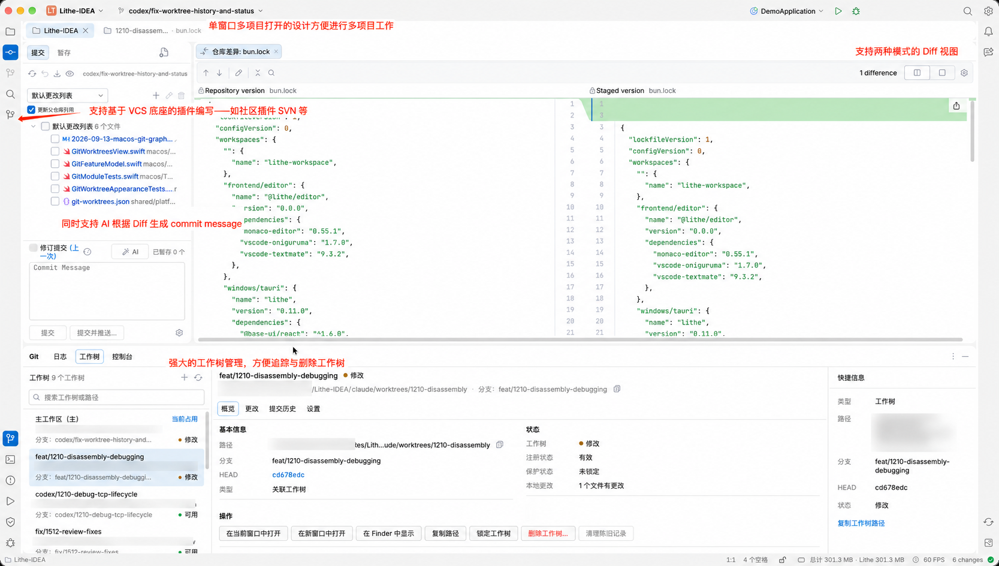</a>
</p>

### 全局搜索与 Markdown 预览

双击 Shift 搜索文件、符号和操作；Markdown 支持双栏编辑、预览和目录导航。

<p align="center">
  <a href="./docs/assets/screenshots/search-everywhere-markdown.png">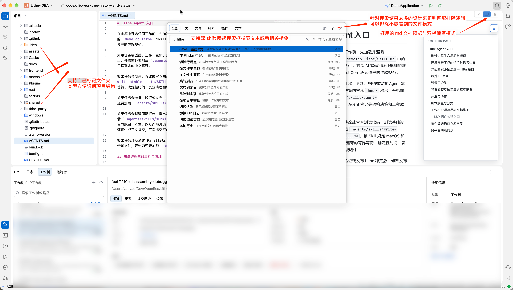</a>
</p>

### Git 历史与分支浏览

结合分支列表、提交图、筛选器和变更文件浏览 Git 历史。

<p align="center">
  <a href="./docs/assets/screenshots/git-history-markdown.png">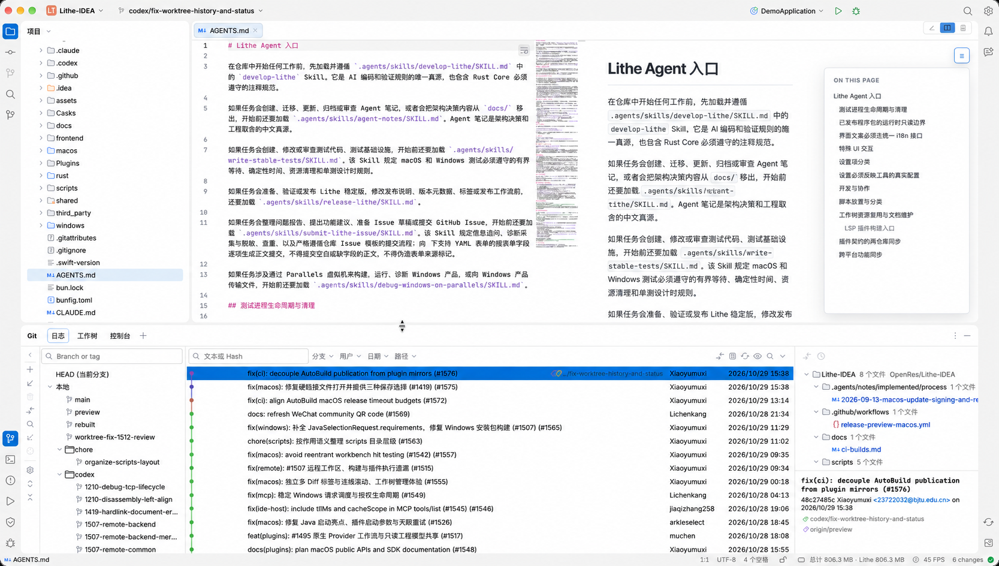</a>
</p>

### HTML 预览与运行服务

并排编辑和预览 HTML，在运行面板中查看项目入口与服务配置。

<p align="center">
  <a href="./docs/assets/screenshots/html-preview-run-services.png">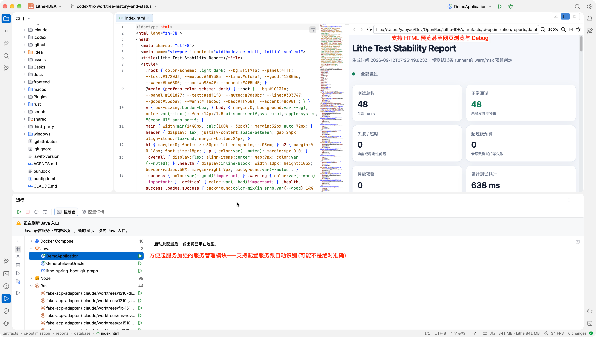</a>
</p>

### 插件管理与原生调试

管理语言服务、构建和调试插件；图中同时展示 LLDB 反汇编与寄存器视图。

<p align="center">
  <a href="./docs/assets/screenshots/plugins-native-debugging.png">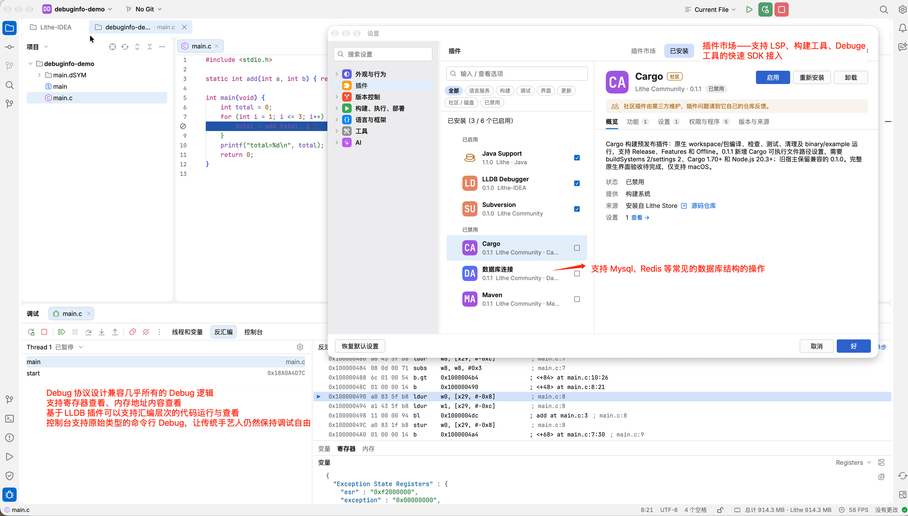</a>
</p>

### AI 对话与上下文

在编辑区中与 Agent 对话，展开命令执行记录，查看上下文用量、文件更改和会话统计。

<p align="center">
  <a href="./docs/assets/screenshots/agent-chat-context.png"></a>
</p>

### Agent 资源与 MCP 配置

集中管理 Agent 的指令、技能、Hooks 和 MCP 配置，在对话中查看运行耗时与 Token 用量。

<p align="center">
  <a href="./docs/assets/screenshots/agent-mcp-settings.png">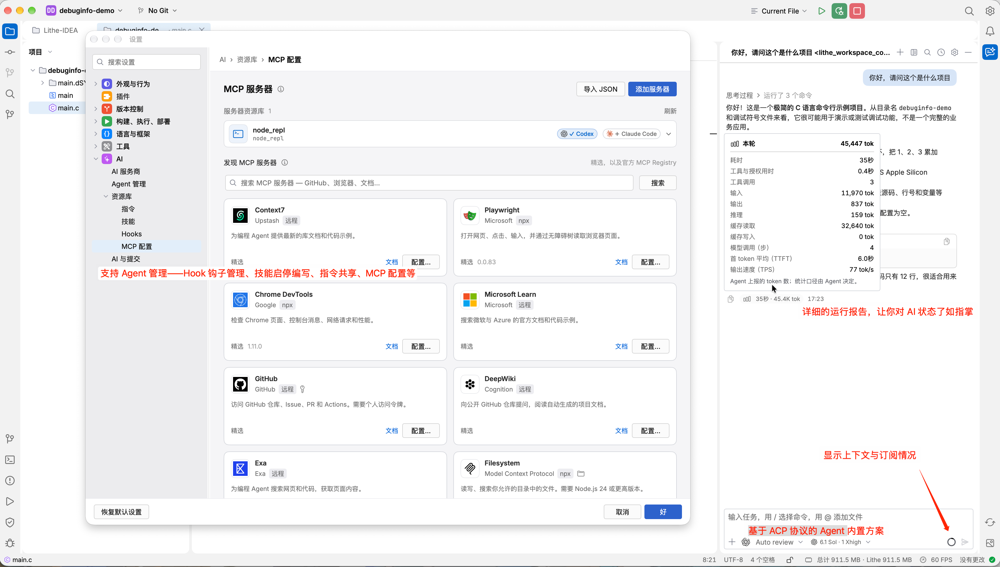</a>
</p>

</details>

## 欢迎加入群聊

欢迎加入 Lithe 社区，分享使用体验、交流问题，并获取项目最新动态。

<div align="center">
<table>
  <tr>
    <th>QQ群</th>
    <th>微信群</th>
  </tr>
  <tr>
    <td align="center"><a href="https://qm.qq.com/cgi-bin/qm/qr?k=&amp;group_code=163027877"></a></td>
    <td align="center"><a href="https://gcnctzuuwe9u.feishu.cn/wiki/HJFbwZ0hZirAPnkWF3xcPWkCnid?from=from_copylink"></a></td>
  </tr>
</table>
</div>

如果无法扫描微信群二维码，[点击这里通过飞书加入群聊](https://gcnctzuuwe9u.feishu.cn/wiki/HJFbwZ0hZirAPnkWF3xcPWkCnid?from=from_copylink)。

---

## 项目支持

### ❤️ 赞助商

<p align="center">
  <a href="https://www.fastaitoken.com/">
    
  </a>
</p>
<p align="center">
  <a href="https://www.fastaitoken.com/"><strong>FastAI</strong></a><br>
  FastAI 提供多款主流大模型的便捷中转服务，让开发者可以更轻松地把 AI 能力接入日常开发流程。其支持也帮助 Lithe 持续完善 AI 辅助体验。感谢 FastAI 对本项目的支持！欢迎扫码加入 FastAI Token 交流群②（群号：1073874006）。
</p>

<p align="center">
  <a href="https://pateway.ai/?ch=68i69k">
    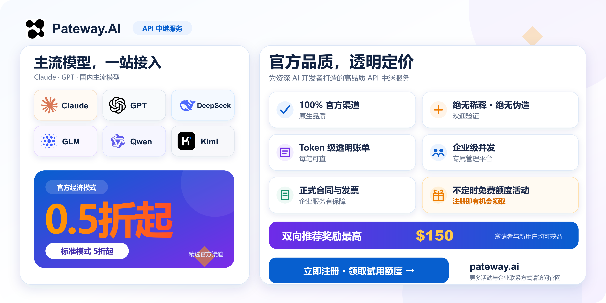
  </a>
</p>
<p align="center">
  感谢 PatewayAI 对本项目的赞助！<br>
  PatewayAI 专注于官方高质量模型 API 中继，完整支持 Claude、GPT 系列以及各类国内主流模型，并提供透明计费与企业级服务。<br>
  经济模式低至 0.5 折！<a href="https://pateway.ai/?ch=68i69k">通过此链接注册可获试用额度</a>，还可参与不定时活动领取免费额度，双向推荐奖励最高达 150 美元。
</p>

<p align="center">
  <a href="https://apinebula.ai/ref/8dhC67x0">
    
  </a>
</p>
<p align="center">
  感谢 APINEBULA 赞助本项目！<br>
  APINEBULA 是银河录像局旗下的企业级 AI 聚合平台，通过一个 API 接入 Claude、GPT、Gemini 等主流模型，价格低至 1 折，支持高并发、正式合同、对公打款与开票，适用于 AI 编程、Agent 开发和业务系统集成。<br>
  <a href="https://apinebula.ai/ref/8dhC67x0">通过此链接注册</a>，首次充值时填写优惠码 <strong>Lithe</strong>，可享九折优惠。
</p>

<a href="mailto:2188718831@qq.com">想显示在下方？</a>

<table>
  <tr>
    <td width="112" align="center">
      <a href="https://timicc.com">
        
      </a>
    </td>
    <td>
      <a href="https://timicc.com"><strong>TIMI CC</strong></a> 是企业级 AI 中继平台，专注于稳定性与优质服务，为 Claude Code、Codex 等主流 AI 编程工具提供快速、稳定、高质量的模型接入服务。
    </td>
  </tr>
  <tr>
    <td width="112" align="center">
      <a href="https://torchai.ai/sign-up?aff=FdkE">
        
      </a>
    </td>
    <td>
      <a href="https://torchai.ai/sign-up?aff=FdkE"><strong>TorchAI</strong></a> 提供便捷的大模型中转服务，覆盖编程、内容生成和自动化等场景。感谢 TorchAI 对 Lithe 的支持！
    </td>
  </tr>
  <tr>
    <td width="112" align="center">
      <a href="https://zeusnorun.com/register?ref=AZD4UMG9">
        
      </a>
    </td>
    <td>
      <a href="https://zeusnorun.com/register?ref=AZD4UMG9"><strong>Zeus 宙斯中转站</strong></a> 提供 GPT、Claude、Grok 及 GPT Image 中转服务，最低 0.08 倍率，支持开票与对公付款。
    </td>
  </tr>
  <tr>
    <td width="112" align="center">
      <a href="https://dash.clidex.dev">
        
      </a>
    </td>
    <td>
      <a href="https://dash.clidex.dev"><strong>Clidex</strong></a> 提供 AI 基础设施和原生 AI 命令行工具 API 接入，价格低至官方 API 的 0.08 折。感谢 Clidex 对 Lithe 的支持！
    </td>
  </tr>
  <tr>
    <td width="112" align="center">
      <a href="https://www.atlascloud.ai/zh">
        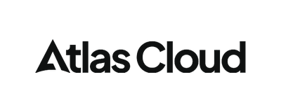
      </a>
    </td>
    <td>
      <a href="https://www.atlascloud.ai/zh"><strong>Atlas Cloud</strong></a> 提供 <strong>400 多种模型</strong>的 AI 中转服务，开发者可以在同一平台探索和比较模型。感谢 Atlas Cloud 对 Lithe 的支持！
    </td>
  </tr>
  <tr>
    <td width="112" align="center">
      <a href="https://www.compshare.cn?ytag=GPU_YY_YX_git_litheidea">
        
      </a>
    </td>
    <td>
      <a href="https://www.compshare.cn?ytag=GPU_YY_YX_git_litheidea"><strong>优云智算 Compshare</strong></a> UCloud 旗下 AI 云平台，提供 GPU 算力及包月、按次的国模 Coding Plan，支持 Claude Code、Codex 和 API 接入。H3 视频生成套餐低至 0.08 元/秒，支持 2K 分辨率及最长 30 秒视频；支持企业高并发、7×24 技术支持和自助开票。
    </td>
  </tr>
  <tr>
    <td width="112" align="center">
      <a href="https://codezsy.com/register?aff=fDyA">
        
      </a>
    </td>
    <td>
      <a href="https://codezsy.com/register?aff=fDyA"><strong>CodeZ</strong></a> 专注于 GPT 系列模型的稳定中转，为开发者集成模型 API 提供直接选择。感谢 CodeZ 对 Lithe 的支持！
    </td>
  </tr>
</table>

### ⭐ 特别鸣谢

<p align="center">
  <a href="https://linux.do/">
    
  </a>
</p>

<p align="center">
  <strong>关于 AI 的一切，欢迎前往 <a href="https://linux.do/">LINUX DO</a>！祝社区越来越好～</strong>
</p>

### 贡献者

感谢所有参与 Lithe 开发和改进的贡献者。

<a href="https://github.com/1lck/Lithe-IDEA/graphs/contributors">
  
</a>

### License

Lithe 采用 [Apache License 2.0](./LICENSE) 授权。

## Star History

<a href="https://www.star-history.com/#1lck/Lithe-IDEA&Date">
  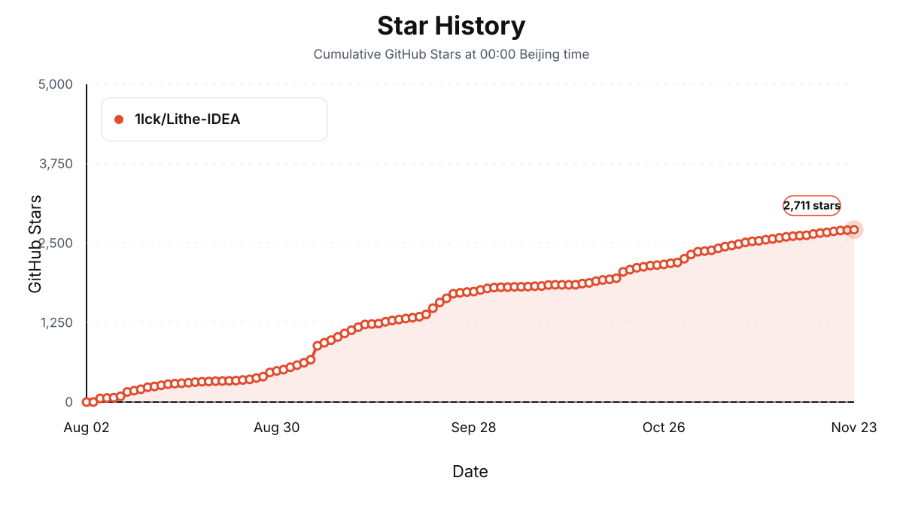
</a>
