# Agent 紧凑对话布局的原生截图

这些图像来自实际 SwiftUI/AppKit 组件的受控测试回放，使用示例模型、消息和用量。没有使用用户项目、真实账户或凭据，也没有调用真实模型服务。测试宿主可能使用后备图标，因此这里验证布局与状态，不替代发行包图标资源、WindowServer 合成或真实供应商验收。

## 同一场景的布局前后

下表使用相同的 `nativeModelFallbackAndPermissionPriorityRemainVisible` 测试、事件和窗口尺寸。左列复用 `preview` 中已经提交的模式提示修复截图（`after-*` 指该独立修复完成后、**本 PR 布局调整前**）；右列是合并该修复后的本次回放。两列都保留有效的 Auto 降级提示。本 PR 把标题收为一行，活动入口放回三段栏，配置移入输入框底部。

| 主题和宽度 | preview 原布局 | 本 PR 紧凑布局 |
| --- | --- | --- |
| 深色，280pt |  | 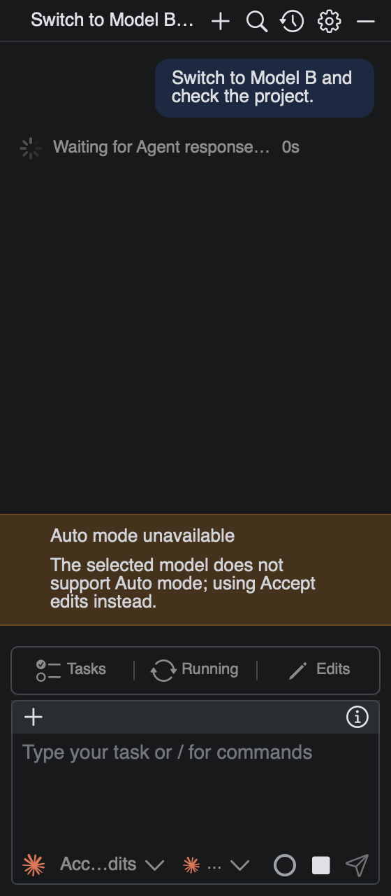 |
| 浅色，280pt |  | 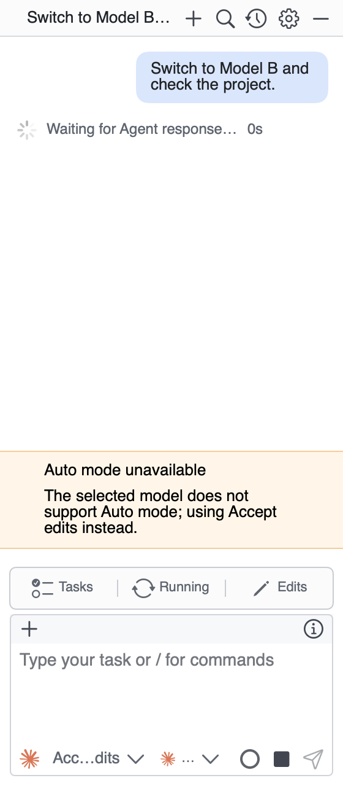 |
| 深色，480pt |  | 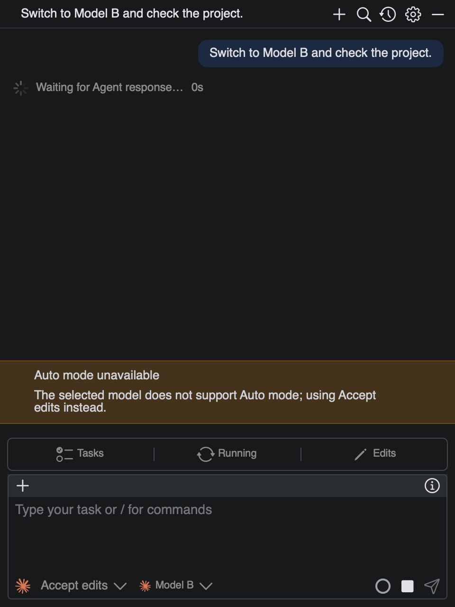 |
| 浅色，480pt |  | 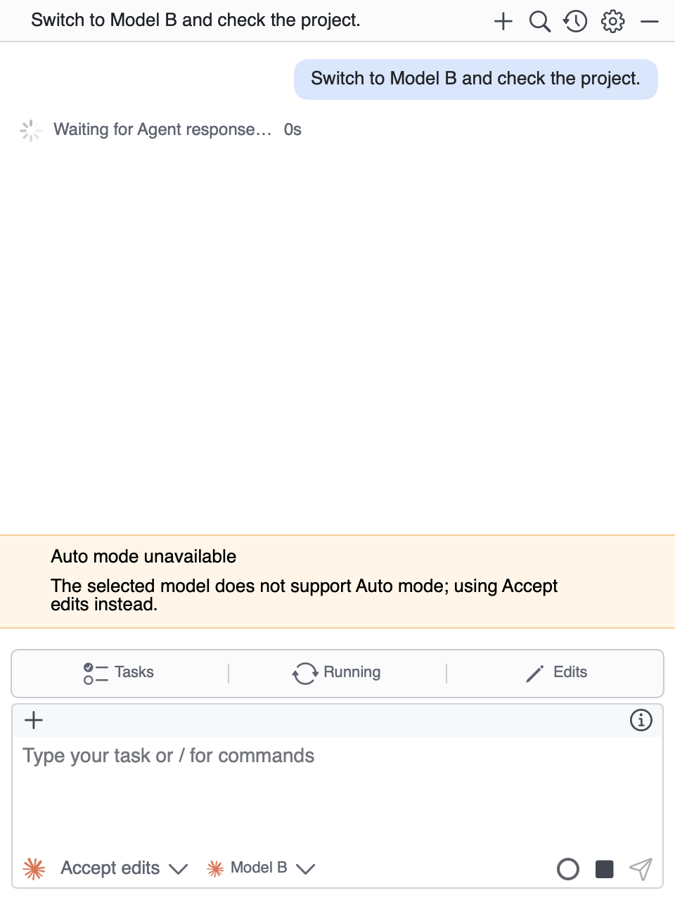 |

## 工具窗口和编辑页

`classicHistoryRoundTripPreservesDraftAndConnection` 在 417pt 工具窗口、900pt 编辑页回放同一对话。思考和工具内容、单行标题、活动栏与草稿均来自真实视图；测试另验证历史页往返不会创建连接或丢失草稿。

| 宿主 | 深色 | 浅色 |
| --- | --- | --- |
| 工具窗口，417pt | 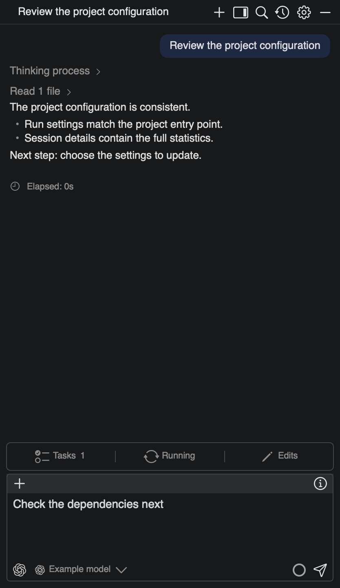 | 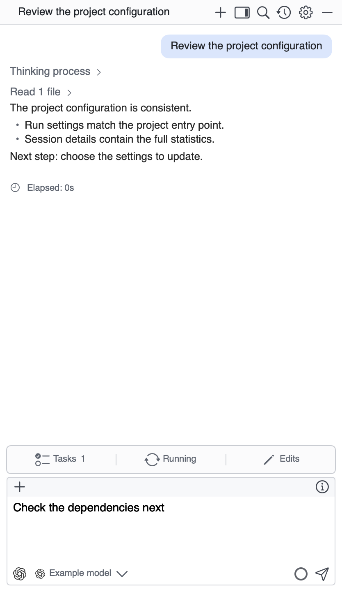 |
| 编辑页，900pt | 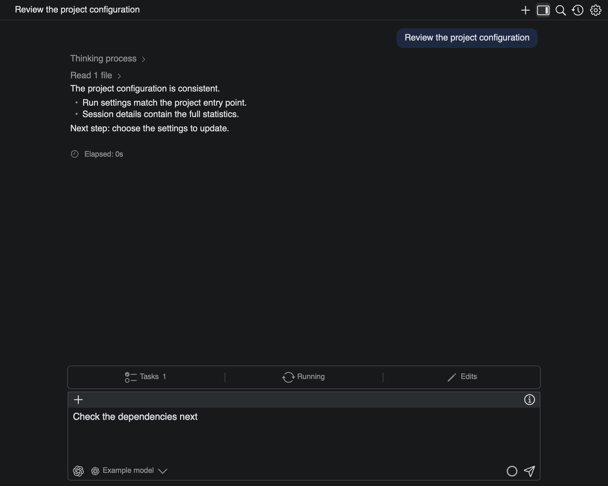 | 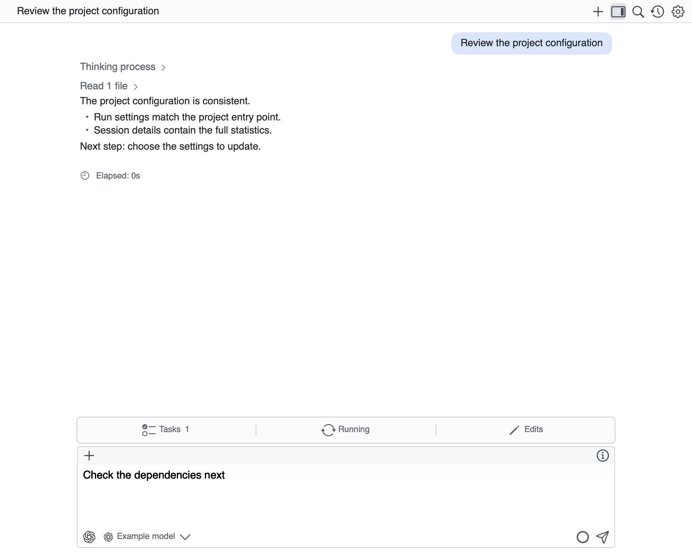 |

## 上下文明细

以下是 300pt 独立明细组件的中文快照：大号真实使用率、已用/容量、多色容量条、估算分项和工具数量。四类分项保留 `~`，有数据时不常驻解释脚注。测试也覆盖 264pt 详情栏、英文和缺失数据。

| 深色 | 浅色 |
| --- | --- |
| 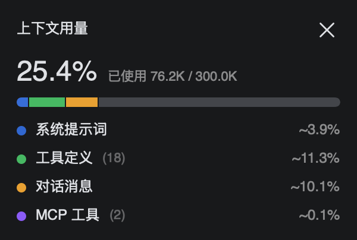 | 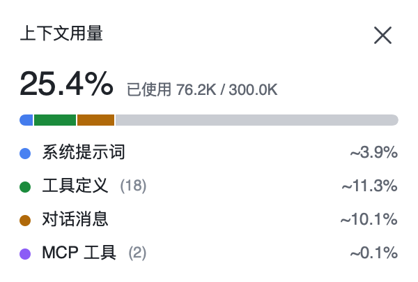 |

## 额度摘要与悬停卡片内容

第一行是 280pt 宿主中输入框上方的折叠摘要；第二行单独挂载悬停卡片的实际内容组件，使用同一灰轨进度条和分窗口布局。示例数据为五小时已用 75%、七天已用 36%，分别显示黄色和绿色；示例重置时间与账号均为测试数据。这里的组件快照不冒充真实鼠标悬停截图；鼠标移入、移开和会话切换清理由共享悬停组件回归及此前实际预览操作验证。

| 状态 | 深色 | 浅色 |
| --- | --- | --- |
| 默认摘要 | 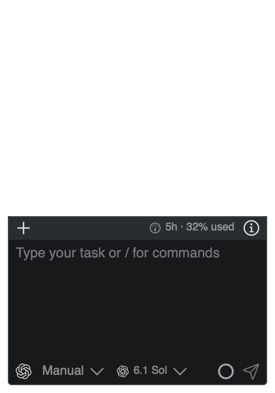 | 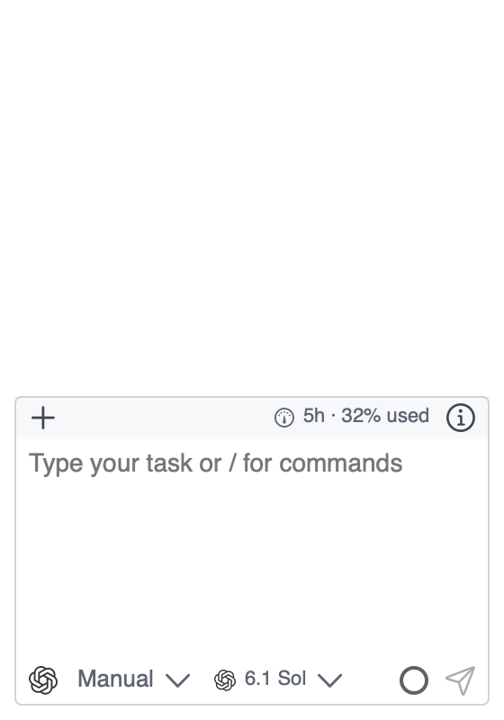 |
| 悬停卡片内容 | 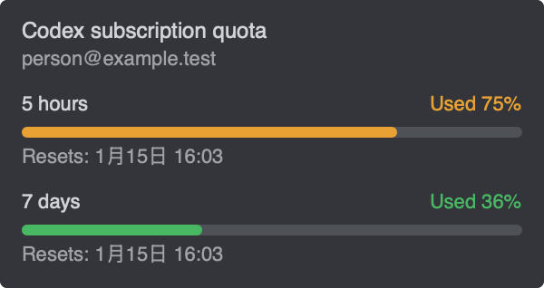 | 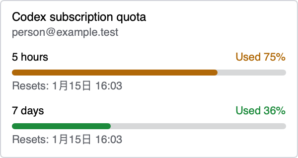 |

## 重现

先创建调用方拥有的 `.artifacts/agent-review-1280/screenshots/`，在仓库根目录执行：

```sh
LITHE_AGENT_CLASSIC_SCREENSHOTS="$PWD/.artifacts/agent-review-1280/screenshots" \
LITHE_AGENT_SELECTOR_SCREENSHOTS="$PWD/.artifacts/agent-review-1280/screenshots" \
LITHE_AGENT_STATUS_SCREENSHOTS="$PWD/.artifacts/agent-review-1280/screenshots" \
LITHE_AGENT_NOTICE_REVIEW_SCREENSHOTS="$PWD/.artifacts/agent-review-1280/screenshots" \
  ./.agents/skills/write-stable-tests/scripts/test-stability-macos.sh -- \
  --filter 'AgentConversationSelectionTests|AgentConversationPresentationTests|AgentSessionSelectorLayoutTests'
```

截图为文档静态材料，不被产品读取，不进入应用资源包、安装目录或跨 worktree 资源缓存。每次测试都清理自己创建的窗口和连接。
