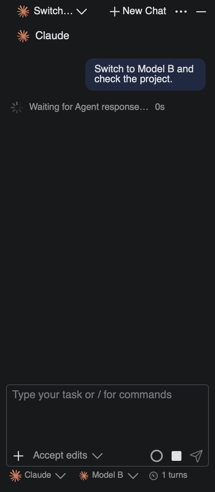
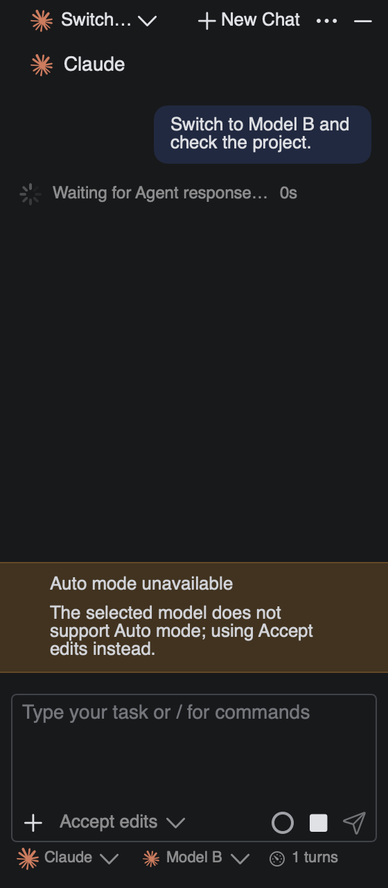
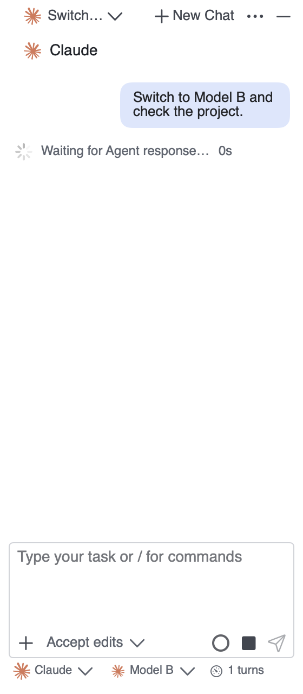
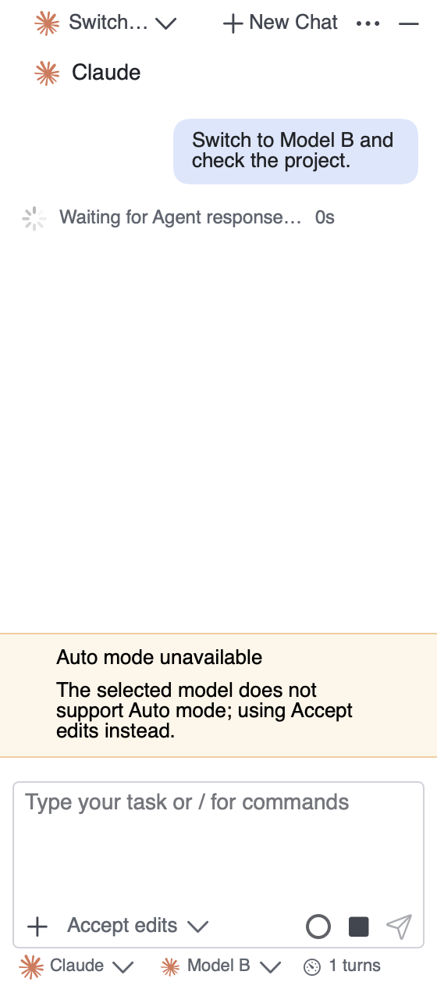
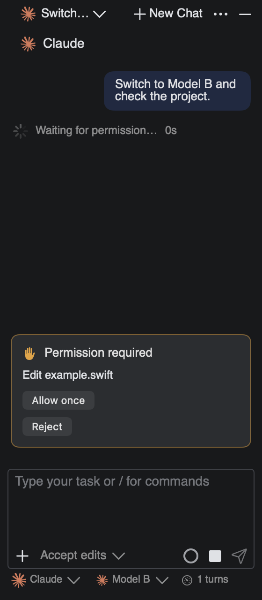
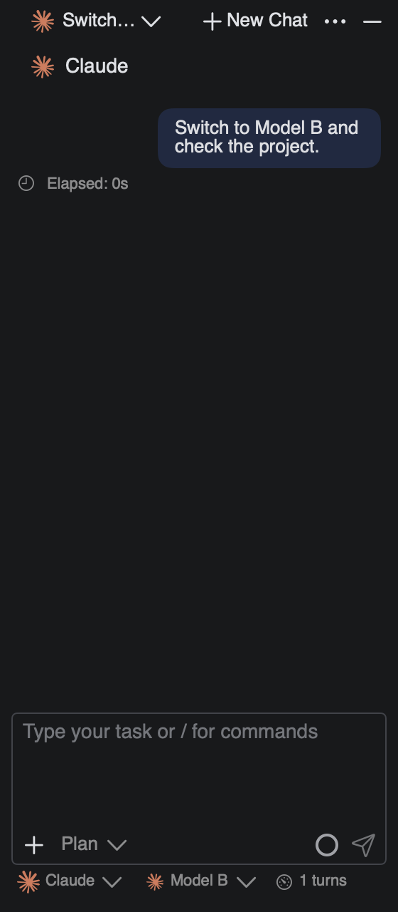
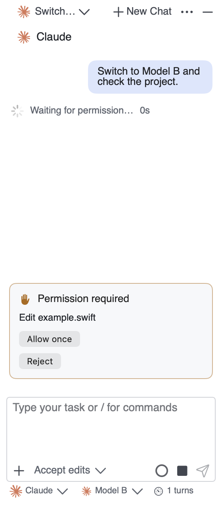
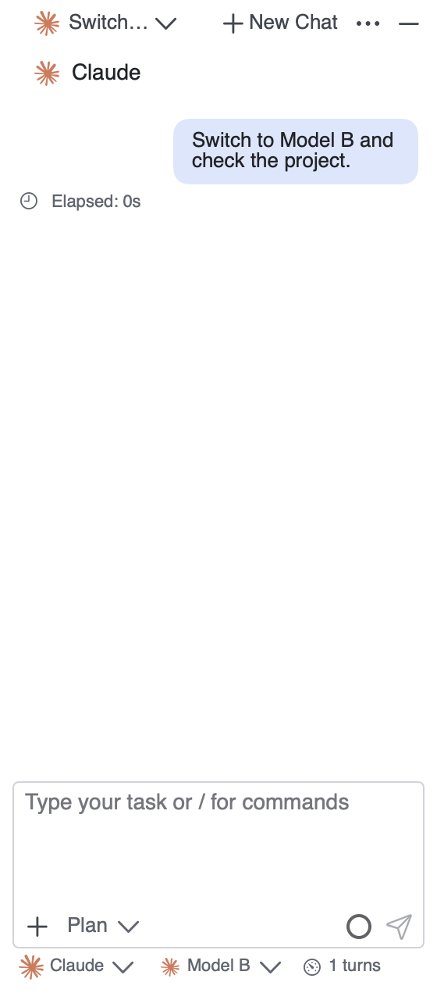
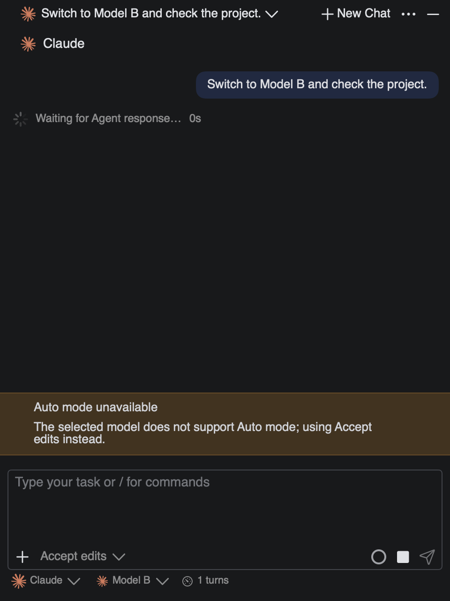
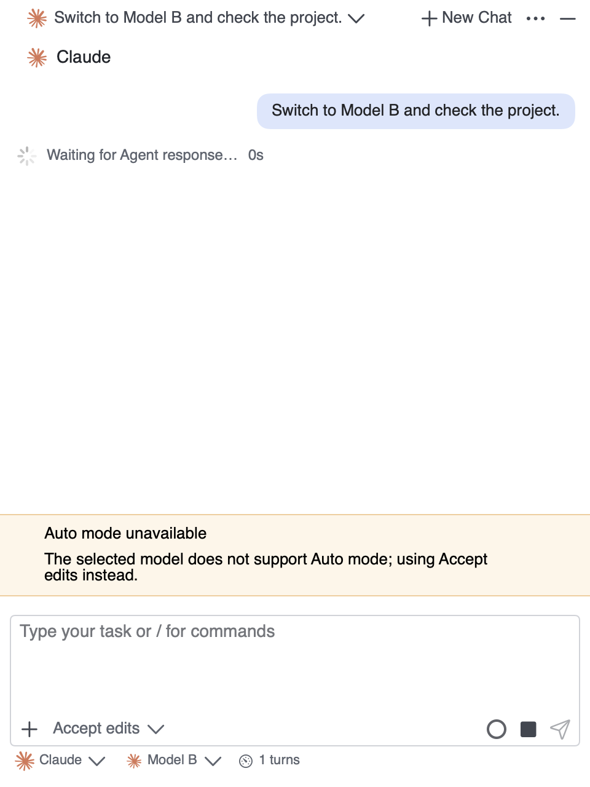

# Claude 模式通知的原生回放对比

这些截图由 `AgentConversationSelectionTests.nativeModelFallbackAndPermissionPriorityRemainVisible` 挂载实际 macOS 对话视图生成，使用受控 ACP 事件、示例模型和文件路径。它们不包含用户项目或凭据，也不代表真实供应商端到端验收。窗口为 280pt 窄面板或 480pt 面板、640pt 高，分别使用深浅主题；PNG 保留原生渲染尺寸。

本次 review 修复前后使用同一测试、相同输入与窗口尺寸。修复前版本已经合入本次 preview 的代码并解决冲突，但尚未加入通知转换身份逻辑；对应回归实际失败。修复后版本应保留新降级通知，同时让后续模型切换清除旧通知。测试宿主未打包完整 IDEA 图标资源，部分图标槽位为空，因此这些图像用于核对真实控件的文字、布局和状态，不作为发行包图标验收。

## 原生模型切换前后

测试先建立模型 A、Auto 模式的会话，不发出本地配置请求。随后依次注入 `current_mode_update(acceptEdits)`、新降级 `notice` 和包含模型 B 的 `config_option_update`。下表中的两张图都取自最后一个事件之后：修复前通知消失，修复后通知保留。

| 主题 | 修复前，280pt | 修复后，280pt |
| --- | --- | --- |
| 深色 |  |  |
| 浅色 |  |  |

## 权限优先和 Plan 清理

通知仍有效时收到权限请求，实际视图优先展示权限卡；答复后再显示通知。上游确认切到 Plan 后，过期的 Auto 通知被清除。以下均为修复后的同一次回放。

| 主题 | 等待权限，280pt | 切到 Plan，280pt |
| --- | --- | --- |
| 深色 |  |  |
| 浅色 |  |  |

## 480pt 面板

| 深色 | 浅色 |
| --- | --- |
|  |  |

## 重现方式

先创建调用方拥有的截图目录，再从仓库根目录执行：

```sh
LITHE_AGENT_NOTICE_REVIEW_SCREENSHOTS="$PWD/.artifacts/notice-review/after" \
  ./.agents/skills/write-stable-tests/scripts/test-stability-macos.sh \
  -- --filter nativeModelFallbackAndPermissionPriorityRemainVisible
```

测试失败和成功均关闭窗口与连接。图像是静态验证材料，不作为产品运行时资源读取，不新增下载或共享缓存，也不修改已安装 app bundle。
