# 远程主机下拉的界面证据

截图来自真实 Viva Page 的无头渲染，使用 `TestVisualRemoteWorkspace` 的受控测试输入。
保存的 SSH 连接经过真实 Core 保存和读取；网络、主机目录、WSL 与容器进程由现有测试替身提供。
它们证明界面和交互状态，不代表已经连接真实 SSH 主机、Windows WSL 或容器引擎。

- 改前基线：`b6eab0b36`，改前版本的 `TestVisualRemoteWorkspace`。
- 改后版本：本 PR 中的 `TestVisualRemoteWorkspace`，与实现代码一起提交。
- 环境：macOS arm64，Go 1.27.4，Core `e8927412b6324636f2636b58c521758451d97fc4`，Viva `448b0553faf8`。
- 窗口：1200 × 760 逻辑像素，PNG 保留原始 2× 渲染尺寸 2400 × 1520。
- 主题与语言：浅色英文 `en-US`、深色中文 `zh-CN`（设置值 `zh-Hans`）。

复现命令从仓库根目录运行，输出目录按采集版本选择 `before` 或 `after`：

```bash
LITHE_VISUAL_OUTPUT_DIR="$PWD/.artifacts/visual/remote-host-switcher/after" \
  ./scripts/desktop/desktop-go.sh test -tags='vivahead dev lithevisual' \
  ./internal/workbench -run '^TestVisualRemoteWorkspace$' -count=1 -timeout=120s
```

这里保存用于 PR 评审的原始 PNG；其余测试产物留在当前检出的 `.artifacts/`，不进入发行包。

## 顶部入口前后对照

| 主题 / 语言 | 改前：底部显示连接状态 | 改后：顶部主机名与连接图标 |
| --- | --- | --- |
| 深色中文 | 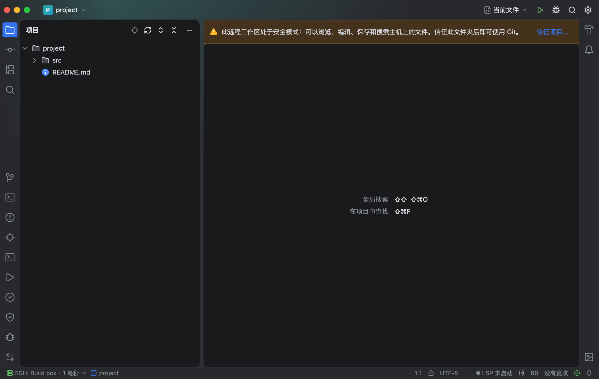 | 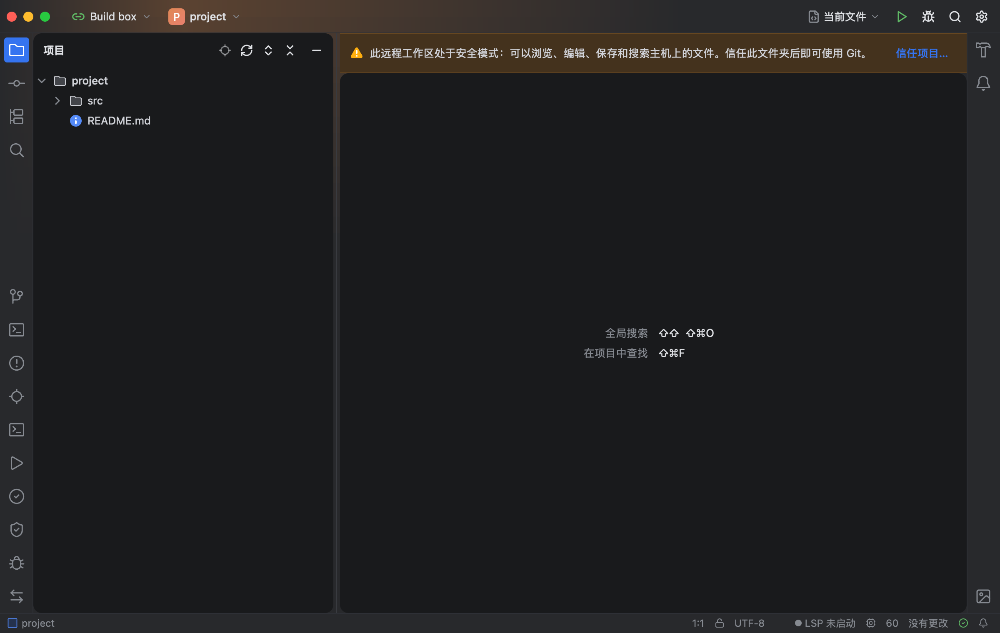 |
| 浅色英文 | 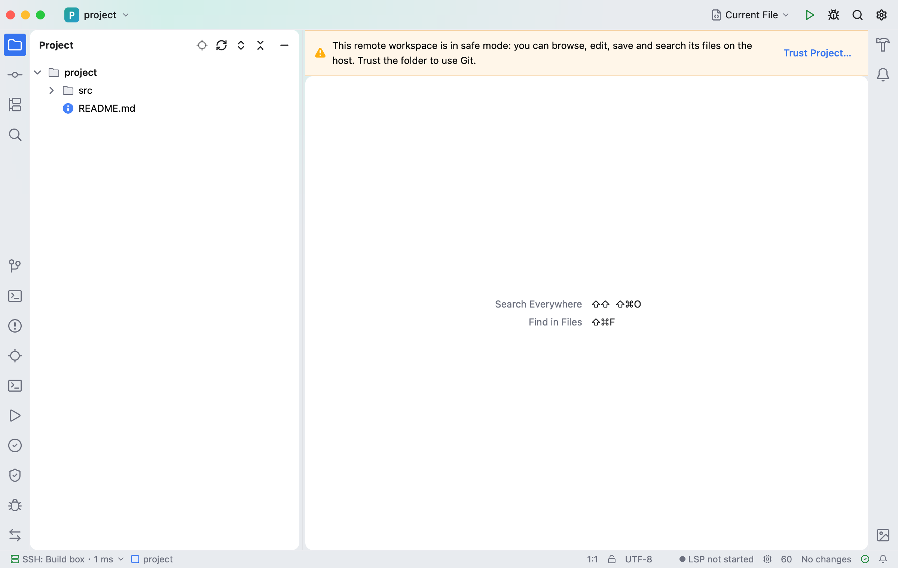 |  |

## 下拉和切换后的文件夹弹窗

| 主题 / 语言 | 改前菜单 | 改后可直接选择主机 | 选中容器后的文件夹弹窗 |
| --- | --- | --- | --- |
| 深色中文 | 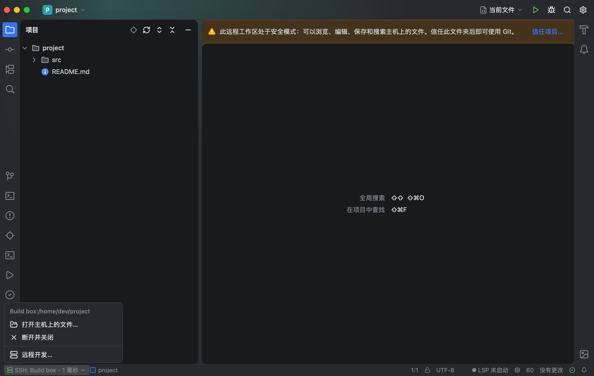 | 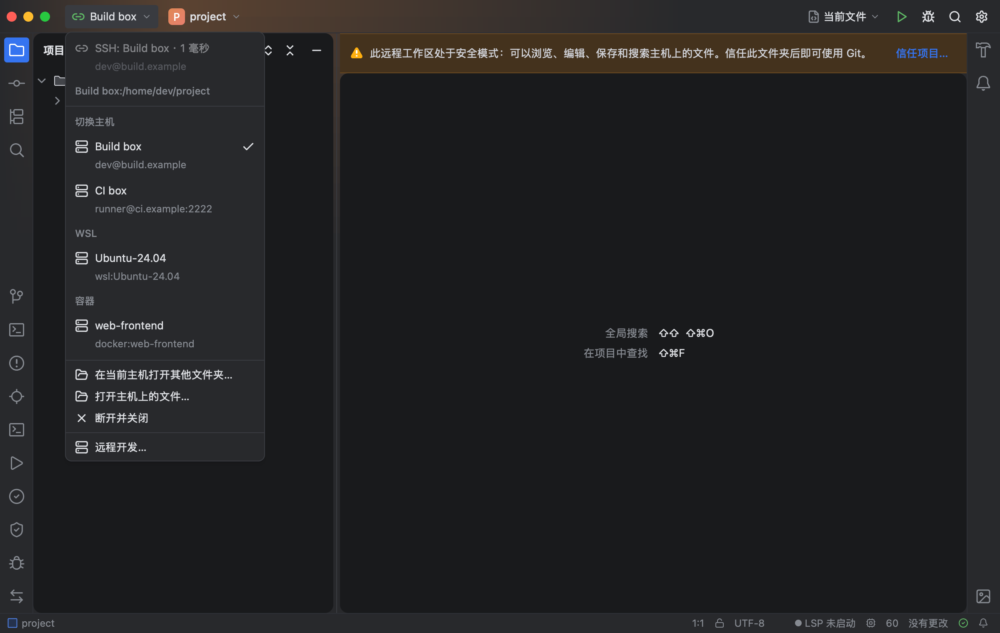 | 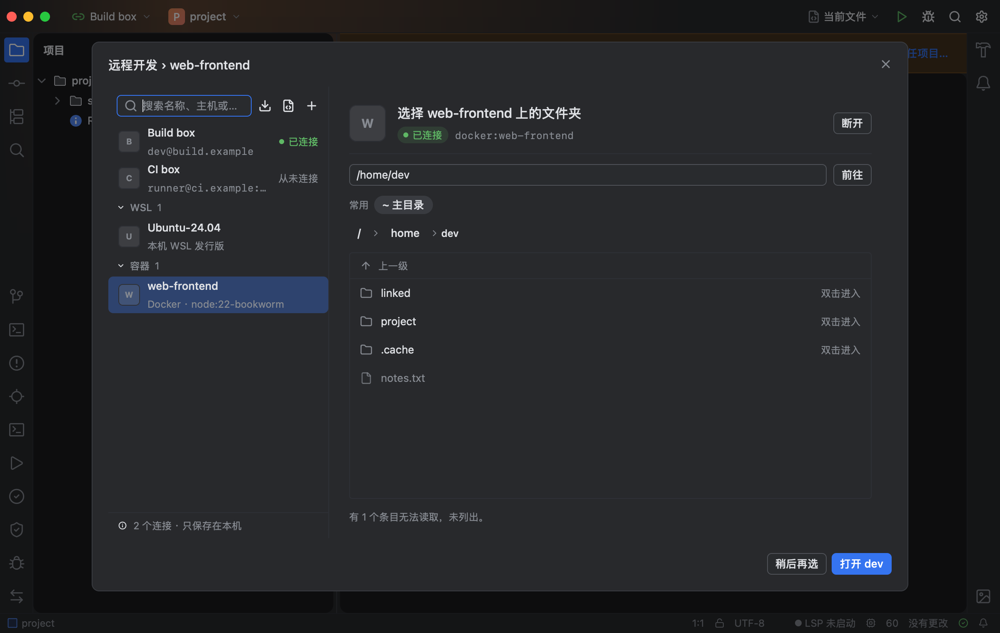 |
| 浅色英文 | 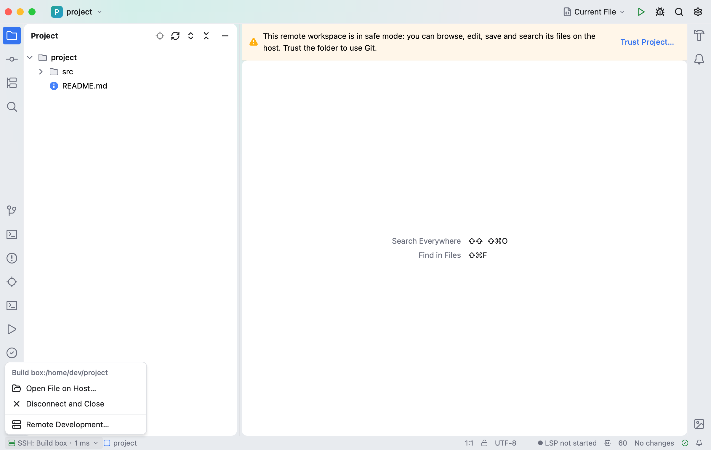 | 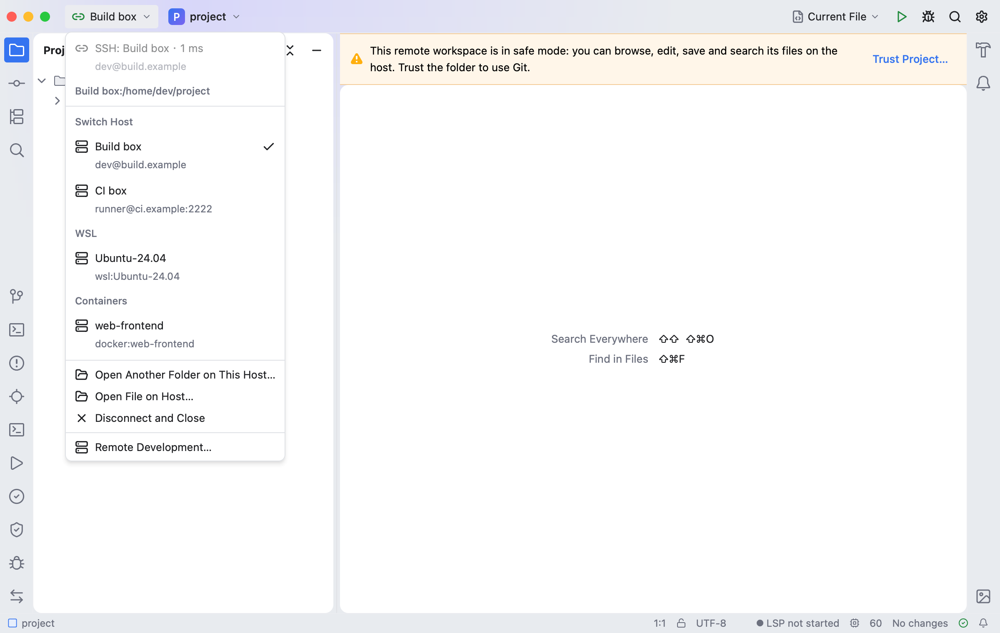 | 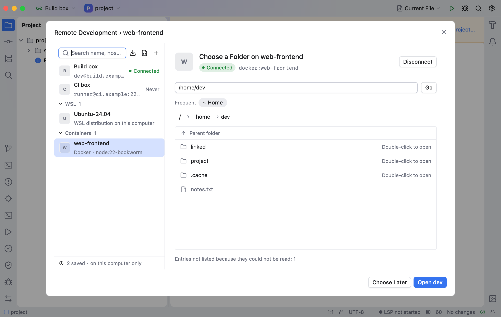 |

## 图标状态

| 状态 | 深色中文 | 浅色英文 |
| --- | --- | --- |
| 无响应 |  |  |
| 重连中 |  | 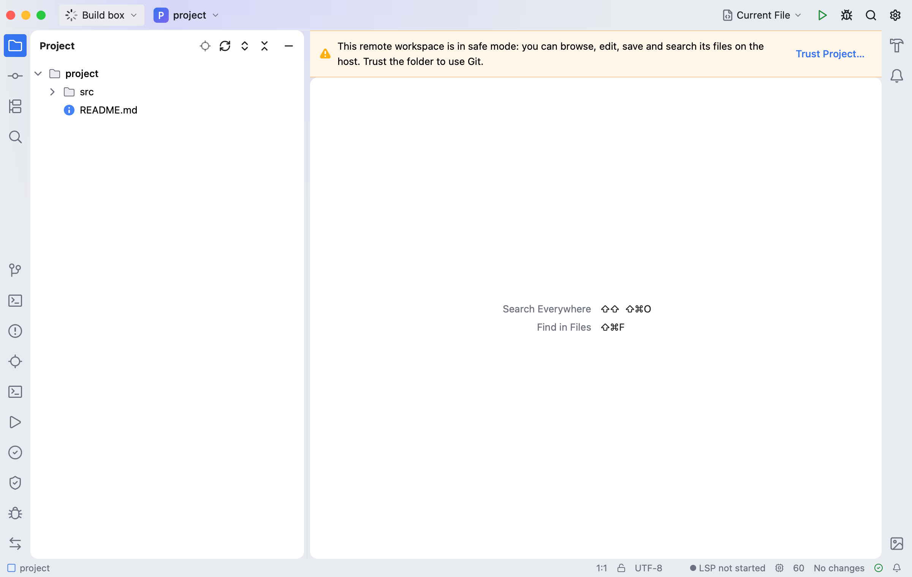 |
| 已断开 | 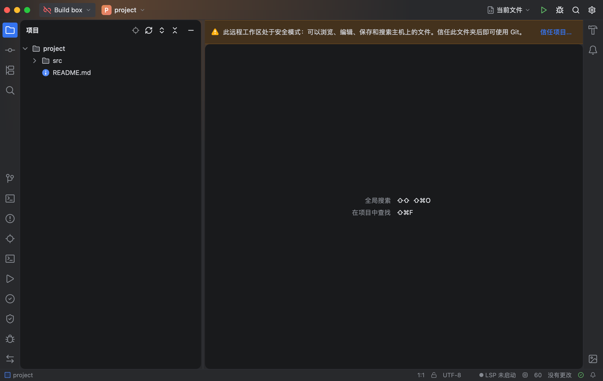 |  |
