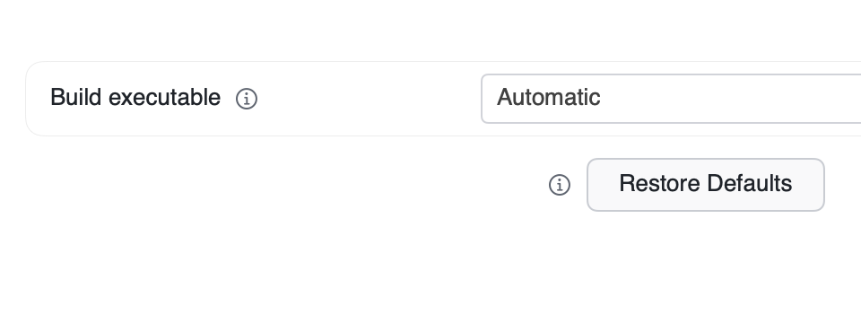
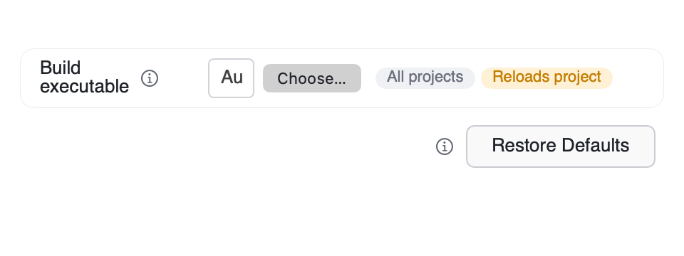
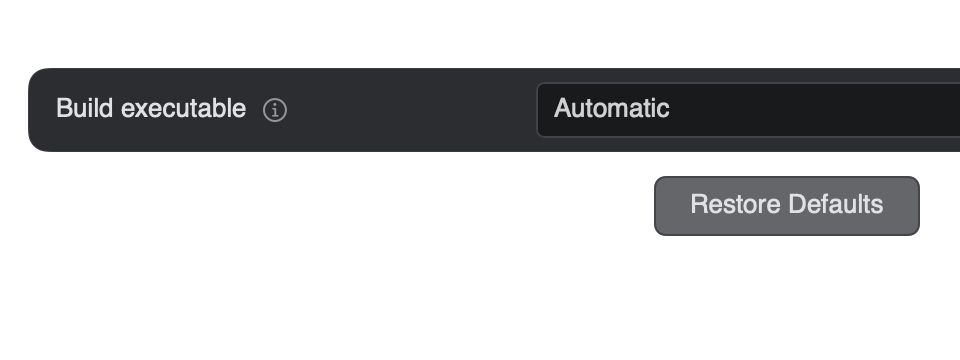
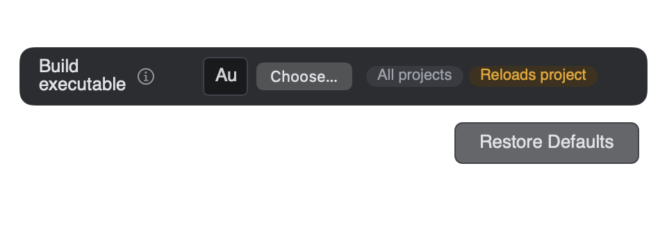
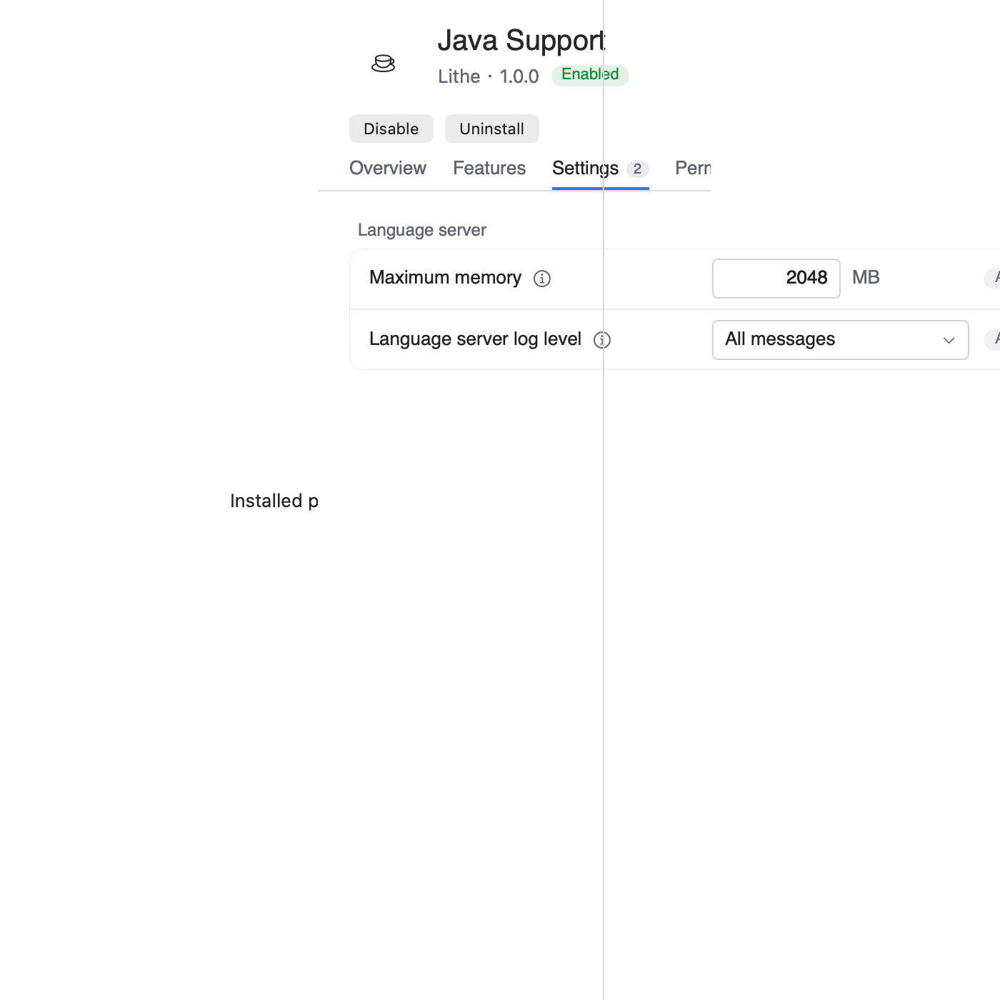
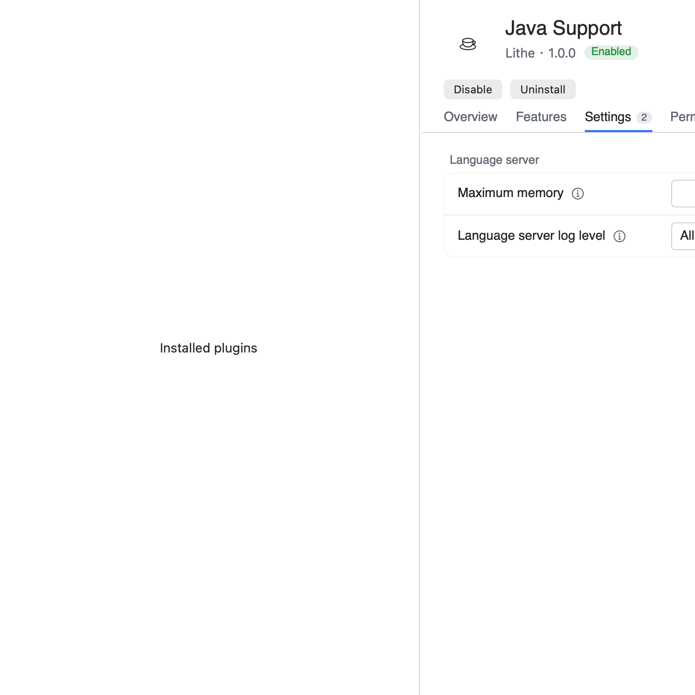
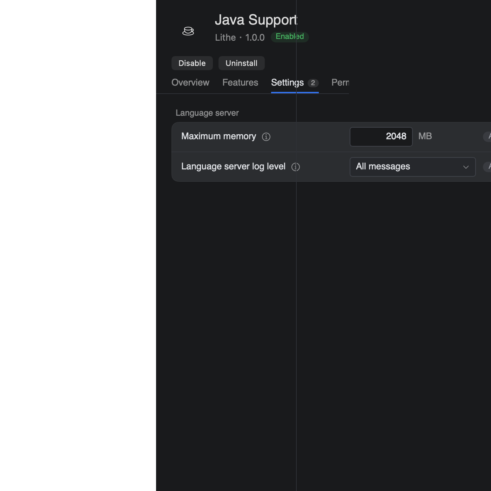
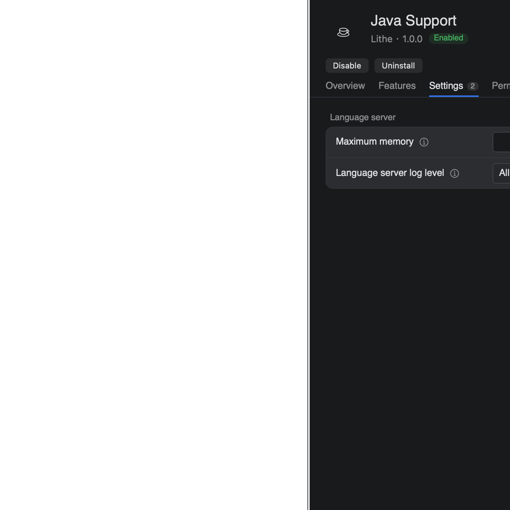

# 插件路径控件和详情分栏的原生截图

以下图像使用 `PluginSettingsLayoutTests`、`PluginDetailLayoutTests` 中相同的
SwiftUI/AppKit 视图、示例数据、尺寸和主题。原布局取自 PR 基线
`fe0b31c71f692bbb60bf938da9c47498bbd1d0ec` 的三个视图文件；当前布局包含
`fc653d5c0` 和 `589906520` 两个独立 UI 修复提交。此次 Runtime/Provider 修复
没有继续修改布局实现。

截图由原生视图绘制生成，测试宿主的左栏是占位文字；不代表完整产品窗口或
真实桌面合成验收。前后图均在初始未滚动的位置采集。原布局只用于渲染对比；
当前布局另外运行完整的几何、输入实例、横向滚动与路径选择断言。

## 路径控件，480pt 宿主

原布局里的输入框固定占宽，按钮文字被挤掉。当前布局保留选择按钮的自然宽度，
标题与输入框随可用空间缩短，右侧的作用域与生效标签仍可见。

| 主题 | PR 基线 | 当前布局 |
| --- | --- | --- |
| 浅色 |  |  |
| 深色 |  |  |

## 插件详情，700 × 700pt 分栏宿主

原布局的详情内容越过分隔线进入左栏。当前布局接受分栏宽度，内容留在分隔线
右侧；窄设置表单可横向滚动。回归还验证 900、1000 和 1100pt 宽度，以及
窗口高度变化时的顶部对齐和输入框实例保持。

| 主题 | PR 基线 | 当前布局 |
| --- | --- | --- |
| 浅色 |  |  |
| 深色 |  |  |

## 验证出口

在仓库根目录运行完整断言及当前布局截图导出：

```sh
LITHE_PLUGIN_SETTINGS_LAYOUT_CAPTURES="$PWD/.artifacts/plugin-layout-check" \
LITHE_PLUGIN_DETAIL_LAYOUT_CAPTURES="$PWD/.artifacts/plugin-layout-check" \
  ./.agents/skills/write-stable-tests/scripts/test-stability-macos.sh -- \
  --filter 'PluginSettingsLayoutTests|PluginDetailLayoutTests'
```

标准导出的详情图在横向滚动到末端后采集，便于检查右侧设置是否仍可访问。
本表另在同一视图布局完成后、滚动前采集，以保持前后位置一致。
截图是文档静态材料，不被产品加载，也不进入应用资源包、安装目录或工作树
资源复用清单。测试窗口由各用例关闭，不保留临时应用或后台进程。
