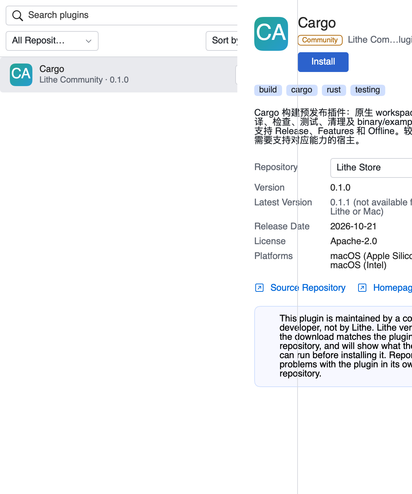
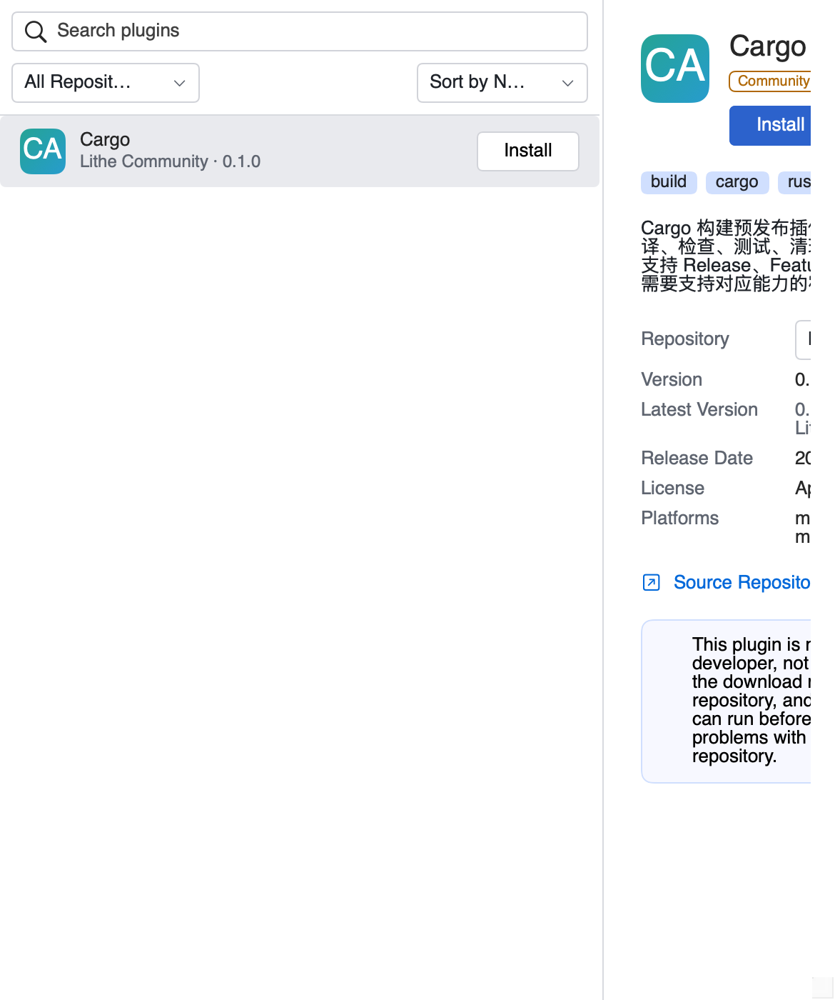
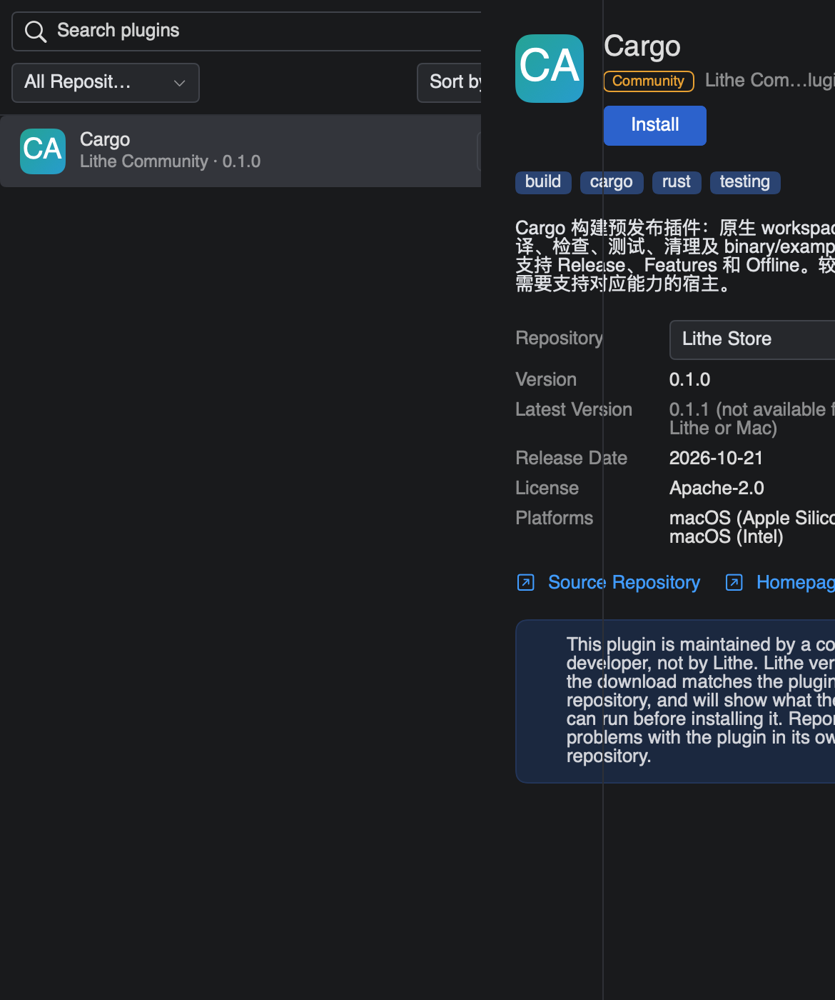
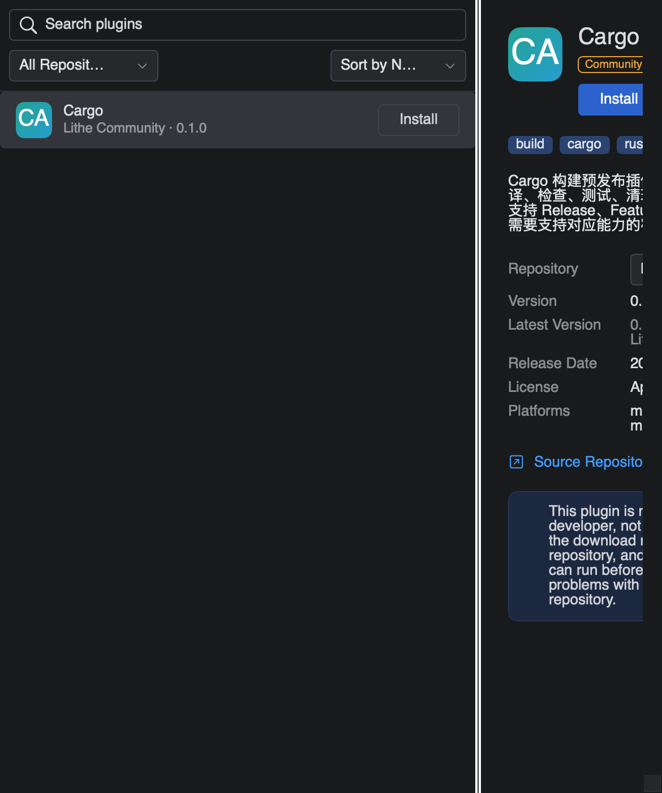

# 插件市场详情的分栏边界

市场详情在窄面板下曾越过分隔线，遮住左侧列表。原因是详情的信息行、来源
选择器和提示卡有最小宽度，纵向滚动容器按内容宽度布局后，整个详情向左偏移。
“已安装”的详情是另一套视图，因此之前的已安装布局回归没有覆盖这个入口。

修复后，市场详情的视口接受分栏分配的宽度。正文在宽面板内换行，在极窄面板内
保留完整内容并允许横向滚动；图标、名称和说明均不会绘制到分隔线左侧。
短正文在窗口高度改变后保持顶部对齐。

## 同一页面的前后对比

图像来自 `PluginMarketplaceLayoutTests` 驱动的真实市场页，使用内存索引、两个
示例仓库和中文插件描述，没有访问网络或执行安装。窗口为 585 × 700pt，左栏
为 420pt，详情视口为 160pt。原布局取自 preview `1fba19412`，仅补充与当前相同的
辅助功能标识，用同一份测试和断言验证；原布局失败，当前布局通过。

| 主题 | 修复前 | 修复后 |
| --- | --- | --- |
| 浅色 |  |  |
| 深色 |  |  |

修复后截图处于横向滚动起点，右侧未显示的信息仍在同一滚动文档里。回归另验证
滚动可到达文档末端。图像是隔离测试宿主的原生视图绘制，不代表完整发行应用、
真实桌面合成或用户实机验收；界面固定文字使用测试宿主的语言资源。

## 复现和验证

```sh
LITHE_MARKETPLACE_LAYOUT_CAPTURES="$PWD/.artifacts/marketplace-layout-check" \
  ./.agents/skills/write-stable-tests/scripts/test-stability-macos.sh -- \
  --filter 'PluginMarketplaceLayoutTests|PluginDetailLayoutTests|PluginSettingsLayoutTests'
```

市场回归覆盖英文/中文描述、深浅主题、窗口宽高变化、原生鼠标拖动、释放后刷新
不移位、极窄视口的横向滚动与顶部对齐。已安装详情和路径控件保留各自的回归。
测试使用独占的 UserDefaults 偏好域，并在结束后清理偏好域和窗口。

这些 PNG 是静态文档材料，不由产品读取，不进入 app bundle、安装目录或工作树
资源复用清单。产品修改没有新增运行时文件、下载入口或缓存。
